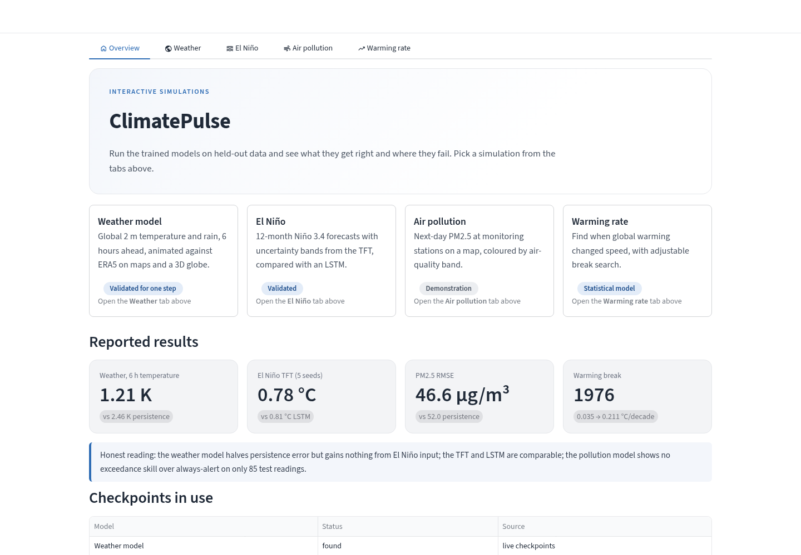
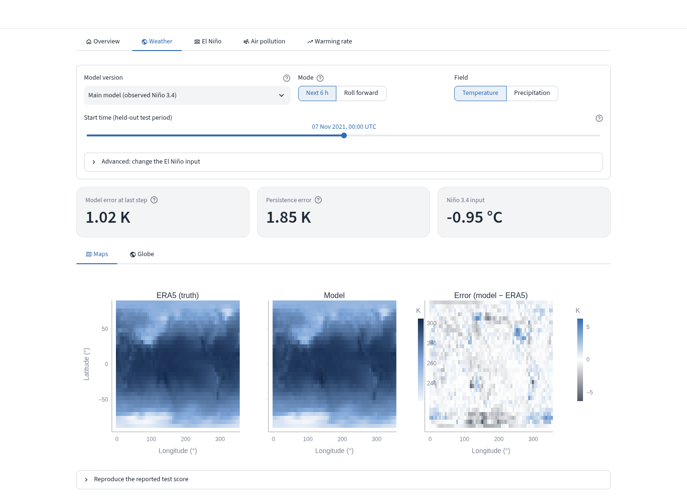
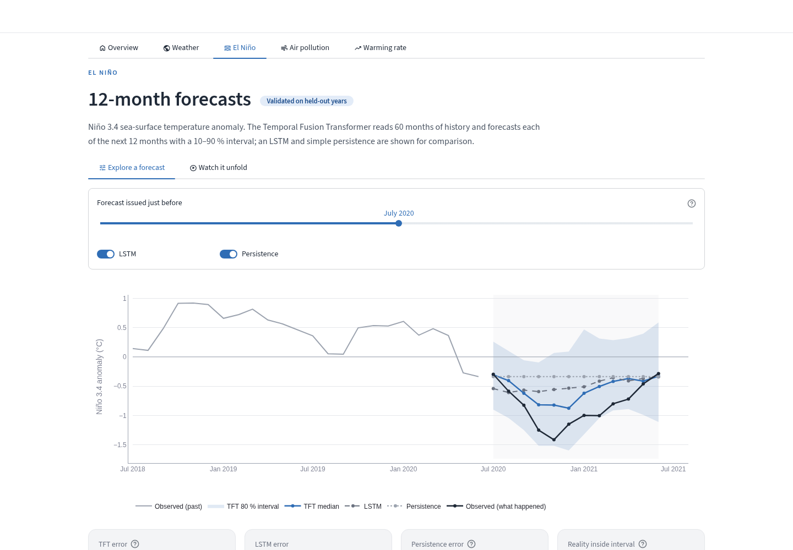
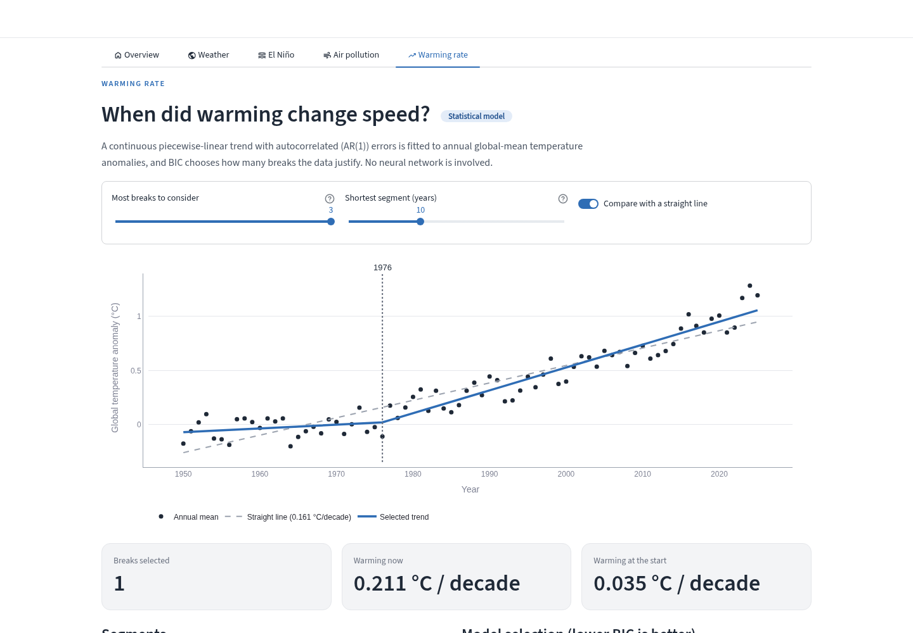

\begin{titlepage}
\raggedright
{\LARGE\bfseries CLIMATEPULSE: TEMPORAL FUSION TRANSFORMERS AND SPATIO-TEMPORAL GRAPH NETWORKS IN CLIMATE MODELING\par}
\vspace{1.2cm}
\centering
{\large\bfseries A\par}
{\large\bfseries Minor Project ([COURSE CODE]) Report\par}
\vspace{1cm}
Submitted in the partial fulfillment of the requirement for the degree of\par
\vspace{0.8cm}
{\large\bfseries Bachelor of Technology\par in\par Computer and Communication Engineering\par}
\vspace{1cm}
By:\par
\vspace{0.6cm}
{\large\bfseries ADITRI PAUL\par 2428010209\par}
\vspace{1cm}
Under the supervision of:\par
Dr. Hema Shekhawat (Assistant Professor)\par
\vspace{0.8cm}
\IfFileExists{project_report_figures/muj_logo.png}{\includegraphics[width=6cm]{project_report_figures/muj_logo.png}\par}{}
\vspace{0.8cm}
{\large\bfseries [SUBMISSION MONTH] 2026\par}
\vfill
\rule{\textwidth}{0.4pt}\par
\small
Department of Computer and Communication Engineering\par
School of Computing and Intelligent Systems\par
Manipal University Jaipur\par
VPO. Dehmi Kalan, Jaipur, Rajasthan, India -- 303007\par
\end{titlepage}

\setcounter{page}{1}

\begin{center}
{\Large\bfseries STUDENT DECLARATION}
\end{center}

\vspace{0.5cm}

This is to certify that the work entitled \textbf{``CLIMATEPULSE: TEMPORAL FUSION TRANSFORMERS AND SPATIO-TEMPORAL GRAPH NETWORKS IN CLIMATE MODELING''} submitted by \textbf{Aditri Paul (2428010209)} to Manipal University Jaipur for the award of the degree of Bachelor of Technology in Computer and Communication Engineering is a bonafide record of the work carried out by her under my supervision and guidance from July 2026 to [END MONTH] 2026.

\vspace{3cm}

\textbf{Dr. Hema Shekhawat} Internal Supervisor,

Department of Computer and Communication Engineering

Manipal University Jaipur

\clearpage

\begin{center}
{\Large\bfseries PROJECT COMPLETION CERTIFICATE}

\vspace{0.8cm}

\textbf{DEPARTMENT OF COMPUTER AND COMMUNICATION ENGINEERING}

\vspace{0.3cm}

\textbf{SCHOOL OF COMPUTING AND INTELLIGENT SYSTEMS}

\vspace{0.3cm}

\textbf{MANIPAL UNIVERSITY JAIPUR}

\vspace{0.3cm}

VPO. Dehmi Kalan, Jaipur, Rajasthan, India -- 303007
\end{center}

\vspace{0.8cm}

This is to certify that \textbf{ADITRI PAUL} (Registration No. \textbf{2428010209}), a student of the Bachelor of Technology in Computer and Communication Engineering, has successfully completed the Project Based Learning [NUMBER] entitled: \textbf{``CLIMATEPULSE: TEMPORAL FUSION TRANSFORMERS AND SPATIO-TEMPORAL GRAPH NETWORKS IN CLIMATE MODELING.''}

This project was carried out during the [SEMESTER] semester in partial fulfillment of the requirements for the award of the B.Tech degree. The work has been found to be satisfactory and meets the academic standards of the institution.

\vspace{3cm}

\textbf{Dr. Hema Shekhawat}

Project Supervisor

Assistant Professor, Dept. of CCE

# ABSTRACT

This report details the conceptualization, design, development and evaluation of "ClimatePulse," an open-source Python pipeline that brings four climate-modelling tasks together in one reproducible workflow. Climate questions span very different time scales and data shapes: a monthly ocean index, a network of air-quality sensors, a global weather field on a sphere and a 75-year temperature record. They are usually studied with separate tools, separate data handling and separate evaluation rules, which makes results hard to compare or rebuild. ClimatePulse instead shares one data pipeline, one configuration system, one chronological split policy and one evaluation code base across four models.

The four components are: (1) a **Temporal Fusion Transformer (TFT)** that forecasts the Niño 3.4 sea-surface temperature anomaly 1 to 12 months ahead with 10–90 % uncertainty intervals, compared with a bidirectional LSTM; (2) an **A3TGCN spatio-temporal graph network** that predicts next-day PM2.5 at 75 OpenAQ monitoring stations; (3) an **encoder–processor–decoder graph network on a 2,000-node Fibonacci spherical mesh** that predicts global 2 m temperature and precipitation 6 hours ahead from ERA5 reanalysis, with an optional Niño 3.4 conditioning input; and (4) a **piecewise-linear trend with autocorrelated errors** that detects changes in the global warming rate from NASA GISTEMP data. All five data sources are public, and every model is scored against a persistence baseline on a strictly held-out test period.

On the test period, the TFT averages an RMSE of 0.782 °C over five seeds (LSTM 0.809 °C, persistence 1.036 °C); the weather model halves the persistence error for 6-hour 2 m temperature (1.21 K vs. 2.46 K); the pollution model is 10 % more accurate than persistence on concentration but shows no exceedance skill on only 85 observed test readings; and the warming-rate analysis finds a single regime change around 1976, from 0.03 to 0.21 °C per decade. An ablation shows that the Niño 3.4 conditioning of the weather model gives no measurable benefit. A Streamlit application lets users run the trained models on held-out data and see where they succeed and where they fail. Every figure and number in this report can be rebuilt from a fresh clone with one ordered sequence of `make` commands, on a CPU.

\tableofcontents

# 1. INTRODUCTION

## 1.1 Problem Statement

Climate phenomena operate across very different scales. The El Niño–Southern Oscillation (ENSO) evolves over months and shifts rainfall and temperature worldwide; urban air pollution changes from day to day and is shaped by local sources and weather; the global atmosphere changes every few hours; and the warming trend unfolds over decades. Deep learning has produced strong single-task models for several of these problems, but students and researchers who want to study them together face a fragmented landscape.

The key challenges in this setting include:

- **Siloed tools and data handling:** Each task normally comes with its own download scripts, file formats, preprocessing and evaluation code. Comparing models across tasks, or reusing a forecast from one model as input to another, requires rebuilding much of this machinery by hand.
- **Expensive physical models:** Numerical weather prediction and Earth system models are physically grounded but need supercomputers, which puts them out of reach for student projects and rapid experimentation.
- **Point forecasts without uncertainty:** Many data-driven forecasts return a single number. Decision makers also need to know how confident the forecast is, which calls for calibrated prediction intervals.
- **Data that does not fit a regular grid:** Air-quality sensors are irregular points on a map, and a latitude–longitude grid crowds its points near the poles. Standard convolutional networks assume a regular grid and handle both cases poorly.
- **Optimistic evaluation:** Time-series results are easily inflated by leakage, where information from the test period reaches training through overlapping windows or normalisation statistics. An earlier version of this project suffered exactly this problem (TFT skill 0.91), and a fair evaluation lowered it substantially.
- **Poor reproducibility:** Published numbers are often typed in by hand and cannot be traced back to the run that produced them.

This project addresses these issues by building a single, open-source, CPU-friendly pipeline that downloads public data, trains four complementary models, evaluates them honestly against simple baselines and regenerates every reported figure and table automatically.

## 1.2 Proposed Solution

We propose "ClimatePulse," a modular climate-modelling framework designed around one shared data pipeline and one evaluation discipline. Each of its four modules answers a different climate question with an architecture that matches the shape of its data:

- **El Niño forecasting:** How warm will the tropical Pacific be in 1 to 12 months? A Temporal Fusion Transformer reads 60 months of history and outputs the 10th, 50th and 90th percentile forecast for each of the next 12 months.
- **Air-pollution forecasting:** How much PM2.5 will each monitoring station record tomorrow, and will it exceed the AQI-100 threshold? An A3TGCN graph network treats the stations as nodes of a graph.
- **Neural weather modelling:** What will global temperature and precipitation be in 6 hours? A graph network maps the ERA5 grid onto an evenly spaced spherical mesh, processes it there and maps it back.
- **Warming-rate analysis:** When did the speed of global warming change since 1950? A segmented linear trend with autocorrelated errors is fitted, and the number of breaks is chosen by the Bayesian Information Criterion (BIC).

The user interacts with the system in two ways:

- **Pipeline commands:** A short, ordered sequence of `make` targets downloads the data, trains every model, runs the robustness studies, generates the evaluation artifacts and compiles the documents. Configuration lives in `configs/runtime_conf.yaml` and can be overridden with environment variables.
- **Simulation app:** `make app` opens a browser application that runs the already-trained models on held-out data, so results can be explored without retraining.

Instead of a loose collection of scripts, the outputs form one traceable package:

- **Forecasts with uncertainty:** Quantile intervals for ENSO, per-station PM2.5 predictions and global weather fields.
- **Baseline-relative metrics:** Every model is scored against persistence (carrying the latest value forward), with skill $= 1 - \text{MSE}_\text{model} / \text{MSE}_\text{persistence}$.
- **Robustness studies:** A five-seed study for the El Niño models and a one-change-at-a-time ablation of the weather model.
- **Versioned snapshots:** Each run's checkpoints, metrics and figures are saved under `runtime/saved/run_<timestamp>/`, and the research paper reads its figures directly from the snapshot it reports.

# 2. SYSTEM ARCHITECTURE AND DESIGN

This chapter details the technical design of ClimatePulse. It outlines the system architecture, the responsibilities of each component, the mapping from functionality to code modules, and the path data takes from download to published result.

## 2.1 System Architecture

The system follows a layered pipeline architecture with five layers: open data sources, a data pipeline that fetches, cleans and caches them, a model layer with one package per task, an evaluation layer that scores every model and writes figures and tables, and an output layer made up of the research paper, the patent application and the interactive app. Each layer communicates with the next only through files on disk (Parquet tables, checkpoints, JSON and CSV results), so any stage can be rerun or inspected on its own.

{width=95%}

### 2.1.1 Component Breakdown

**Technology Stack:**

- **Programming Language:** Python 3.12 (pinned in `.python-version`, `pyproject.toml` and the `Makefile`)
- **Deep Learning:** PyTorch 2.12, PyTorch Geometric 2.8, PyTorch Geometric Temporal (A3TGCN), pytorch-forecasting 1.8 (TFT)
- **Statistical Modelling:** NumPy and SciPy (change-point search), PyMC and ArviZ (optional emissions regression)
- **Data Engineering:** pandas, xarray, zarr and gcsfs (ERA5 from Google Cloud), pyarrow (Parquet storage)
- **Configuration:** Pydantic-Settings v2 with YAML files and environment-variable overrides
- **Interactive App:** Streamlit 1.66 and Plotly
- **Hardware:** Runs on CPU; CUDA, AMD ROCm and Intel NPU (OpenVINO) installs are also supported
- **Source Code Management and Testing:** Git and GitHub; pytest unit tests (`make test`)

**Data Pipeline (`src/data/`):**

- **Responsibility:** Fetches each source through its own connector in `src/data/sources/`, reusing cached downloads where present, cleans it with a source-specific function in `processing/cleaning.py` and derives features in `processing/feature_engineering.py`. It also builds the pollution station graph (`processing/graph_builder.py`). `DataPipeline` is a stateless orchestrator; storage is handled by `storage/db.py`, which writes Parquet tables and registers every source in a JSON metadata file.

**Model Layer (`src/models/`):**

- **Responsibility:** One package per task, each with a dataset module (windowing, splits and training-only normalisation), a model module, a trainer and an evaluation module. Training is started through a single command-line entry point, `src/scripts/train_models.py`, which the `make train-*` targets call.

**Evaluation and Artifacts (`src/scripts/generate_eval_artifacts.py`):**

- **Responsibility:** Loads the trained checkpoints, scores every model on its test split against the baselines, and writes figures, CSV and JSON results and a `metrics_summary.md` to `runtime/eval_artifacts/`. `make save-run` then copies checkpoints and artifacts into a timestamped snapshot.

**Interactive App (`src/app/`):**

- **Responsibility:** Runs the trained models on held-out data in the browser. It never trains or modifies a model, and it labels each page with how far its results are validated.

## 2.2 Component Deep Dive

**Model Roster:**

The core of the project is a set of four models. Each is chosen to fit the structure of its data, and each is tested against a simpler baseline rather than assumed to be better.

1. **Temporal Fusion Transformer (El Niño):**
    - *Task:* Forecasts the monthly Niño 3.4 anomaly for each of the next 12 months from a 60-month history. Inputs are the Niño 1+2, 3, 3.4 and 4 indices, their 3-, 6- and 12-month rolling mean and standard deviation, and the calendar month (as sine and cosine) as a known future input. Gated variable-selection networks weight the inputs, an LSTM encoder–decoder captures local patterns and four-head self-attention looks back over the whole window. Three quantile heads ($\tau$ = 0.1, 0.5, 0.9) are trained with the pinball loss $\rho_\tau(u) = u\,(\tau - \mathbf{1}[u<0])$. The model has 96,047 parameters.
    - *Baselines:* A two-layer bidirectional LSTM (142,668 parameters) and persistence.
2. **A3TGCN Graph Network (Air Pollution):**
    - *Task:* Treats each day's PM2.5 readings as a signal on a 75-node station graph built from the 10 nearest stations by great-circle distance (705 edges, weight $1/(d+1)$ with $d$ in km, edges beyond 500 km dropped). Graph convolution shares information between nearby stations, a GRU tracks the state over 7 snapshots and soft attention weighs those snapshots before a small MLP predicts next-day PM2.5. The model has only 6,984 parameters. Missing station-days are masked out of the loss.
    - *Baselines:* Persistence for concentration, and an "always alert" rule for exceedance days (PM2.5 $\ge$ 35.5 µg/m³, i.e. AQI above 100).
3. **Fibonacci-Mesh Graph Network (Weather):**
    - *Task:* Predicts the next 6-hourly global 2 m temperature and precipitation fields from the previous two on the 5.625° ERA5 grid (2,048 points). An encoder maps the grid onto a 2,000-node Fibonacci spherical mesh, which covers the sphere evenly at any chosen size, unlike latitude–longitude grids that crowd at the poles or icosahedral meshes limited to fixed sizes. Four residual GraphSAGE layers pass messages between mesh neighbours, and a decoder maps the result back to the grid. An optional Niño 3.4 input can be added to every processor layer. Training uses a cosine-latitude-weighted MSE loss. The model has 217,346 parameters.
    - *Baselines:* Persistence, plus an ablation of the Niño 3.4 input and of the loss weighting.
4. **Segmented Trend with AR(1) Errors (Warming Rate):**
    - *Task:* Fits a continuous piecewise-linear trend to 76 annual GISTEMP global means (1950–2025), so that a change-point alters the warming *rate* rather than the temperature level. Errors follow an AR(1) process, fitted by Prais–Winsten generalised least squares, so that year-to-year correlation does not invent breaks. Every placement of 0 to 3 change-points with segments of at least 10 years is fitted, and BIC chooses how many the data justify. No neural network is involved.
    - *Comparison:* A mean-shift CUSUM test, which finds 12 spurious breaks because it tests the level rather than the slope.

## 2.3 Functionality to Module Mapping

To keep the code base clean, each concern lives in its own module under `src/` (imported with `PYTHONPATH=src`):

- **Configuration:** `config.py` defines Pydantic-Settings models for data, model, NWM and logging options. `configs/runtime_conf.yaml` and `configs/dataset_conf.yaml` hold the values, and every path is derived from `PROJECT_ROOT`.
- **Data Ingestion:** `data/sources/` holds one connector per source (`noaa_ersst.py`, `openaq.py`, `nasa_gistemp.py`, `climate_trace.py`); ERA5 is fetched by `scripts/download_nwm_data.py`.
- **Processing and Storage:** `data/processing/` (cleaning, feature engineering, station graph) and `data/storage/db.py` (Parquet and JSON metadata), orchestrated by `data/pipeline.py`.
- **Models:** `models/el_nino/` (TFT and LSTM), `models/pollution/` (A3TGCN), `models/nwm/` (mesh builder, model, dataset, trainer) and `models/climate_feedback/` (change-point model and optional Bayesian regression).
- **Robustness Studies:** `scripts/run_elnino_seeds.py` (five seeds, TFT with and without the calendar year), `scripts/export_tft_forecasts.py` and `scripts/run_nwm_ablation.py`.
- **Evaluation and Figures:** `scripts/generate_eval_artifacts.py` with chart helpers in `visualization/`.
- **Simulation App:** `app/main.py` (entry point and tabs), `app/loaders.py` (all model and data access, with no Streamlit import) and `app/views/` (one module per page).
- **Tests:** `tests/` covers the El Niño split boundaries, the pollution graph and masking, the NWM dataset, the change-point model, configuration and the app loaders.

## 2.4 Data Flow

The life cycle of a complete ClimatePulse run follows a strict, ordered pipeline:

1. **Data Download:** `make download-data` runs `DataPipeline` for NOAA ERSST, OpenAQ, NASA GISTEMP and Climate TRACE; `make download-nwm-data` fetches the ERA5 subset. Cached files are reused.
2. **Model Selection:** `make train-elnino-seeds` trains the TFT (with and without the calendar-year input) and the LSTM over five seeds, and selects the TFT variant by mean *validation* loss before any test result is looked at.
3. **Training:** `make train-elnino`, `make train-pollution` and `make train-nwm` train the main models; the best checkpoint by validation loss is kept in every case.
4. **Robustness Studies:** `make export-tft-forecasts` writes the TFT's out-of-sample lead-1 forecasts, and `make nwm-ablation` trains and scores the three weather-model variants.
5. **Evaluation and Publication:** `make gen-eval-artifacts` scores every model and writes the figures and tables; `make save-run` snapshots the run; `make sync-paper-artifacts` points the paper at that snapshot; and `make gen-research-paper-pdf` compiles the paper.

# 3. IMPLEMENTATION DETAILS

## 3.1 Interactive Simulation App (Streamlit)

The front end is a Streamlit application, launched with `make app`, that runs the trained models on held-out data. It has five tabs: an overview and one tab per simulation. Only the open tab runs, so one page's models are not loaded or re-run for the others.

- **Overview:** Shows the headline results and which checkpoints were found, and whether each came from the live training output or a committed snapshot.
- **Weather:** The user picks any moment in the test period and compares ERA5 truth, the model's prediction and the error, as maps or on a rotatable 3D globe, for temperature or precipitation. The user can switch between the main model and the three ablation variants, override the Niño 3.4 input, and roll the model forward and animate it.
- **El Niño:** A slider selects any 12-month forecast from 2015 to 2026 and shows the TFT median and 10–90 % band against the LSTM, persistence and the observed values, with an animation through the test period and error by lead time.
- **Air pollution:** Predicted and observed PM2.5 are shown on a map, coloured by US EPA air-quality band, and a station can be highlighted to see its recent inputs, prediction and reading.
- **Warming rate:** The user changes the maximum number of breaks and the shortest segment length and watches the fitted trend, the BIC choice and the segment slopes update, with a straight-line fit for comparison.

**Honest badges:** Every page states how far its results are validated: "Validated" for El Niño, "Validated for one step" for the weather model, "Demonstration" for pollution and "Statistical model" for the warming rate. Rolling the weather model forward feeds it its own output, which it was never trained or tested on, so the page warns that errors grow and may exceed persistence.

{width=90%}

{width=90%}

## 3.2 Training and Evaluation Orchestration

The pipeline is driven by a `Makefile` and a single training entry point, so every step can be run on its own or as part of the full sequence.

- **Configuration:** Two layers of configuration keep secrets apart from parameters. Credentials (the OpenAQ API key) live in an untracked `.env` file; operational parameters (epochs, seeds, encoder lengths, NWM conditioning source and loss weighting) live in `configs/runtime_conf.yaml`. Any value can be overridden with an environment variable such as `MODEL_MAX_EPOCHS=5`, which makes quick tests and the Colab notebook (`run.ipynb`) possible without editing files.
- **Training setup:** All networks use PyTorch, a learning rate of $10^{-3}$ and `ReduceLROnPlateau` (factor 0.5). The TFT uses Adam with gradient clipping 0.1 and early stopping after 10 epochs without improvement; the LSTM uses Adam with clipping 1.0 and patience 15; the A3TGCN trains for 100 epochs and keeps the best validation checkpoint; the weather model uses AdamW (weight decay $10^{-4}$) with patience 10. Batch size is 32, except for the A3TGCN, which trains on one graph window per step.
- **Efficient graph batching:** In the weather model, the edge indices for a whole batch are built by offset arithmetic on tensors rather than Python loops, so the per-batch overhead does not grow with batch size.
- **Compute budget:** The networks are small (7k to 217k parameters) and train on a CPU. The main models take about 2.2 hours, almost all of it the weather model (about 2 hours, roughly 90 s per epoch); the robustness studies add about 6 hours, mostly the three ablation variants trained in parallel.
- **Snapshots:** `make save-run` copies checkpoints and artifacts to `runtime/saved/run_<timestamp>/`. The research paper's `artifacts/` folder is a symbolic link to the selected snapshot, so the paper always reads one fixed run. The results in this report come from `run_20261027_230426`, which is committed together with its checkpoints.

## 3.3 Robustness & Error Handling

Forecasting projects rarely fail loudly; more often, results look better than they are. ClimatePulse therefore treats evaluation integrity as its main form of error handling. Six rules apply to every model:

- **Chronological splits:** Data are split 70/15/15 into training, validation and test periods in time order. For El Niño, training runs from January 1950 to August 2003, validation from September 2003 to February 2015, and testing from March 2015 to September 2026. No training target falls in the validation or test period.
- **Training-only statistics:** Normalisation statistics are computed on the training split only and then applied to validation and test data.
- **Persistence baselines:** Every skill score is measured against carrying the latest observed value forward, the minimum any forecast must beat.
- **Multiple seeds and validation-based selection:** El Niño results are reported as mean $\pm$ standard deviation over five seeds, and the TFT variant is chosen on validation loss, never on test results.
- **Physical units and masking:** Pollution is scored in µg/m³ at the AQI-100 threshold, and missing readings are excluded rather than imputed into the score.
- **Ablation:** The weather model's Niño 3.4 input and loss weighting are each tested one change at a time.

Further safeguards in the code:

- **Fault-isolated downloads:** Each source in `DataPipeline.run_all()` runs in its own error handler, so one failing API does not stop the others, and the Climate TRACE connector retries failed requests. Cached downloads are reused so that repeated runs do not hit the APIs again.
- **Helpful failures in the app:** If a checkpoint or data file is missing, the app raises a `DataMissing` error that names the `make` command that creates it, and the page shows that message instead of crashing. Checkpoints are found by searching the live training directory first and then each committed snapshot, newest first, so a fresh clone can run the app without retraining.
- **Unit tests:** The test suite (`make test`) checks, among other things, that El Niño validation and test targets never overlap training targets, that pollution windows and masks are built correctly, and that the change-point model recovers known breaks.

{width=90%}

{width=90%}

# 4. DATA FLOW

## 4.1 Data Flow for Training and Evaluation

The primary execution cycle turns five public datasets into trained models and published metrics:

1. **Ingestion:** NOAA ERSST v5 provides monthly sea-surface temperature from 1950, from which the Niño 1+2, 3, 3.4 and 4 indices are computed. OpenAQ v3 provides PM2.5 readings for stations in India and the United States (an API key is required). NASA GISTEMP v4 provides global temperature anomalies. Climate TRACE v7 provides country-level emissions for an optional regression that no reported result uses. ERA5 from WeatherBench2 provides 6-hourly 2 m temperature and precipitation at 5.625° for 2020–2021 (2,924 time steps).
2. **Processing:** Each source is cleaned by its own function and turned into model-ready features: rolling and seasonal features for the Niño indices (`nino_features.parquet`), daily station means and a 10-nearest-neighbour station graph for OpenAQ, annual means for GISTEMP, and a regridded, subset NetCDF file for ERA5.
3. **Windowing and Splitting:** Inside each model's dataset module, the series is cut into input–target windows and split chronologically. Validation and test windows take their input history from the preceding period, but their targets never overlap earlier splits. Normalisation statistics are fitted here, on training data only.
4. **Training:** Each model is trained on its training windows, monitored on its validation windows, and its best checkpoint by validation loss is saved.
5. **Evaluation:** Checkpoints are scored on the test windows against persistence (and the LSTM or always-alert baselines), predictions are converted back to physical units, and the metrics, figures and tables are written to `runtime/eval_artifacts/` and then frozen in a snapshot.

## 4.2 Data Flow for the Simulation App

The app reads the same checkpoints and evaluation code as the paper, so its numbers match the reported ones:

1. **Tab selection:** When the user opens a tab, Streamlit reruns the script, and only the open tab's page renders.
2. **Resolution:** `app/loaders.py` finds the required checkpoint (live directory first, then committed snapshots) and the required data file, raising `DataMissing` with the fix if either is absent.
3. **Cached loading:** Models and datasets are loaded once and cached, so moving a slider re-runs inference without reloading weights.
4. **Inference:** The page runs the model on the chosen held-out sample. Weather predictions are computed one sample at a time, which gives 1.217 K against the reported 1.214 K computed in batches of 16, because the model's layer normalisation pools statistics across a batch.
5. **Rendering:** Plotly draws the maps, globe, time series and metric cards, using the repository's white, grey and blue theme.

# 5. OUTCOMES AND FUTURE WORK

## 5.1 Project Outcomes and Conclusion

The ClimatePulse project designed, built and evaluated a reproducible pipeline that integrates four climate-modelling tasks. The headline results on the held-out test periods are:

| Model | Result | Baseline | Reading |
|:---|:---|:---|:---|
| El Niño TFT (5 seeds) | RMSE 0.782 ± 0.075 °C, skill 0.43 | LSTM 0.809 °C; persistence 1.036 °C | Beats persistence from 3 months ahead; comparable to the LSTM |
| Air-pollution A3TGCN | RMSE 46.6 µg/m³ | Persistence 52.0 µg/m³ | 10 % better on concentration; exceedance F1 0.828 equals always-alert |
| Weather mesh GNN | T2m RMSE 1.21 K (6 h) | Persistence 2.46 K | Halves persistence error; Niño 3.4 input adds nothing |
| Warming-rate change-points | One break in 1976 | Straight line; CUSUM | 0.035 → 0.211 °C per decade |

- **Functionality:** One pipeline downloads, trains, evaluates and documents all four components. Each module shares the data infrastructure, configuration and evaluation tooling, and none is a standalone script.
- **Forecast quality:** Both learned El Niño models clearly beat persistence. The TFT is the most accurate model at every lead from 3 to 12 months (12-month RMSE 0.856 °C against 0.934 °C for the LSTM and 1.376 °C for persistence in the main run), but across seeds its edge over the LSTM is smaller than its own run-to-run spread. The weather model learns real 6-hour dynamics: its error is half that of persistence, lowest in the tropics (0.84 K) and highest near the poles (1.55 K), and its precipitation error is 24 % below persistence.
- **Scientific honesty:** The evaluation exposes weaknesses as well as strengths. Both El Niño models are biased cold by about 0.3 °C because the test period (mean Niño 3.4 anomaly +0.14 °C) is warmer than the training period (−0.23 °C). The pollution test set has only 85 observed station-days, too few to show exceedance skill. The ablation shows that conditioning the 6-hour weather model on Niño 3.4 gives no benefit, and that feeding it the TFT's forecasts makes it worse (1.335 K), so the proposed cross-model coupling is not supported on two years of data.
- **Transparency:** The simulation app lets anyone explore the results interactively, and its badges and warnings make the limits of each model visible, including the sparsity of the pollution data, which headline numbers hide.
- **Reproducibility and cost:** All data are public, the models train on a CPU, and the full study can be rebuilt from a fresh clone in about 7–8 hours on CPU. The committed snapshot lets results be checked without retraining.

The work also contributed to a draft research paper and a draft patent application covering the Fibonacci-mesh weather model and its loop-free graph batching method.

Ultimately, ClimatePulse shows that a small, open, CPU-trainable pipeline can study ENSO, air quality, global weather and the warming trend under one consistent evaluation, and that holding every model to the same leakage-free standard produces results that are more modest than the architectures' reputations, but trustworthy.

## 5.2 Future Work

To strengthen the scientific results and extend the system, the following enhancements are recommended:

- **Remove the El Niño cold bias:** Diagnose the shared bias and recalibrate the TFT intervals, for example with split conformal quantile regression, which guarantees the nominal coverage of the interval on exchangeable data.
- **Larger pollution record:** Download a longer and denser OpenAQ record (the current download is capped at 10,000 readings) so that exceedance skill can be measured, and add satellite NO₂ and methane data to extend coverage beyond the 75 stations.
- **Multi-year weather training:** Train the weather model on several years spanning different ENSO phases, and at longer lead times, before ENSO conditioning can be properly tested.
- **Other climate oscillations:** Extend the TFT to the Indian Ocean Dipole and the North Atlantic Oscillation to test whether it generalises beyond ENSO.
- **Higher resolution and GPUs:** Move from the 5.625° grid to finer ERA5 resolutions on GPU hardware, which the code already supports, so that smaller-scale weather features can be resolved.

# 6. BIBLIOGRAPHY

- Paul, A., & Shekhawat, H. (2026). ClimatePulse: Temporal Fusion Transformers and Spatio-Temporal Graph Networks in Climate Modeling. Pre-print draft, `docs/research_paper/research_paper.md`.
- Lim, B., Arık, S. Ö., Loeff, N., & Pfister, T. (2021). Temporal Fusion Transformers for Interpretable Multi-horizon Time Series Forecasting. *International Journal of Forecasting*, 37(4), 1748–1764.
- Bai, J., Zhu, J., Song, Y., Zhao, L., Hou, Z., Du, R., & Li, H. (2021). A3T-GCN: Attention Temporal Graph Convolutional Network for Traffic Forecasting. *ISPRS International Journal of Geo-Information*, 10(7), 485.
- Hochreiter, S., & Schmidhuber, J. (1997). Long Short-Term Memory. *Neural Computation*, 9(8), 1735–1780.
- Kipf, T. N., & Welling, M. (2017). Semi-Supervised Classification with Graph Convolutional Networks. *ICLR 2017*.
- Hamilton, W. L., Ying, R., & Leskovec, J. (2017). Inductive Representation Learning on Large Graphs. *NeurIPS*, 30.
- Lam, R., Sanchez-Gonzalez, A., Willson, M., et al. (2022). GraphCast: Learning Skillful Medium-Range Global Weather Forecasting. *arXiv:2212.12794*.
- Keisler, R. (2022). Forecasting Global Weather with Graph Neural Networks. *arXiv:2202.07575*.
- Ham, Y. G., Kim, J. H., & Luo, J. J. (2019). Deep Learning for Multi-year ENSO Forecasts. *Nature*, 573, 568–572.
- Barnston, A. G., Tippett, M. K., L'Heureux, M. L., Li, S., & DeWitt, D. G. (2012). Skill of Real-Time Seasonal ENSO Model Predictions During 2002–11. *Bulletin of the American Meteorological Society*, 93(5), 631–651.
- Prais, S. J., & Winsten, C. B. (1954). Trend Estimators and Serial Correlation. *Cowles Commission Discussion Paper*, Statistics No. 383.
- Schwarz, G. (1978). Estimating the Dimension of a Model. *Annals of Statistics*, 6(2), 461–464.
- Hersbach, H., et al. (2020). The ERA5 Global Reanalysis. *Quarterly Journal of the Royal Meteorological Society*, 146(730), 1999–2049.
- NOAA Extended Reconstructed SST v5. https://psl.noaa.gov/data/gridded/data.noaa.ersst.v5.html
- OpenAQ: Open Air Quality Data. https://openaq.org/
- NASA GISS Surface Temperature Analysis (GISTEMP v4). https://data.giss.nasa.gov/gistemp/
- Climate TRACE: Global Emissions Inventory. https://climatetrace.org/
- WeatherBench 2 Documentation. https://weatherbench2.readthedocs.io/
- PyTorch Documentation. https://pytorch.org/docs/
- PyTorch Geometric Documentation. https://pytorch-geometric.readthedocs.io/
- pytorch-forecasting Documentation. https://pytorch-forecasting.readthedocs.io/
- Streamlit Documentation. https://docs.streamlit.io/
