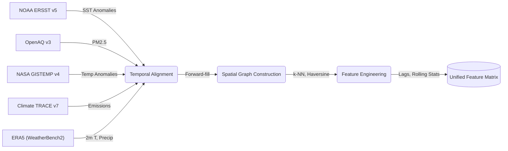
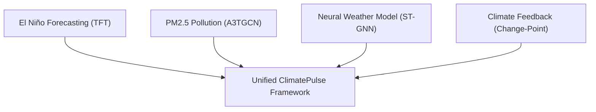

---
header-includes:
  - \usepackage{amsmath}
  - \usepackage{amssymb}
  - \usepackage{unicode-math}
  - \usepackage{fancyhdr}
  - \usepackage[utf8]{inputenc}
  - \usepackage{draftwatermark}
  - \SetWatermarkText{research.aditripaul.org}
  - \SetWatermarkScale{0.25}
  - \SetWatermarkColor[gray]{0.95}
  - \newcommand{\gt}{>}
  - \pagestyle{fancy}
  - '\fancyhead[L]{\small ClimatePulse: Temporal Fusion Transformers and Spatio-Temporal Graph Networks in Climate Modeling}'
  - \fancyhead[R]{\small \today}
  - \fancyfoot[L]{pre-print DRAFT}
  - \fancyfoot[C]{\thepage}
  - \fancyfoot[R]{\footnotesize © 2026 research.aditripaul.org}
  - \renewcommand{\headrulewidth}{0.4pt}
  - \setlength{\headheight}{15pt}
---

# ClimatePulse: Temporal Fusion Transformers and Spatio-Temporal Graph Networks in Climate Modeling

### Authors: Aditri Paul, Dr. Hema Shekhawat
### Manipal University Jaipur


## Abstract

Global climatic phenomena, regional pollution dispersion, and atmospheric field mechanics do not operate in isolation. They form a coupled, multi-scale physical system that no single modelling tradition has adequately captured. ClimatePulse binds four complementary components into one reproducible pipeline: (1) multi-horizon El Niño–Southern Oscillation (ENSO) forecasting via Temporal Fusion Transformers (TFT) with quantile regression; (2) PM2.5 dispersion modelling across 75 global monitoring stations through a 6,984-parameter A3TGCN Spatio-Temporal Graph Neural Network; (3) global weather-field prediction at $5.625^{\circ}$ resolution using a 128-dimensional Encoder-Processor-Decoder Neural Weather Model (NWM) on a 2,000-node Fibonacci spherical mesh, conditioned on the Niño 3.4 index; and (4) piecewise-linear change-point analysis of the global warming rate for climate-feedback analysis.

On a strictly held-out test period (2015–2026), the TFT reaches RMSE = 0.936 °C and anomaly correlation ACC = 0.727 averaged over 1–12 month leads, a skill score of 0.178 against persistence. A bidirectional LSTM baseline scores better on RMSE (0.871 °C, skill 0.289) but worse on ACC (0.510). The TFT tracks ENSO phase but carries a systematic cold bias of −0.68 °C, its 80 % prediction interval covers only 29.8 % of observations, and its skill varies strongly between training runs. For PM2.5 exceedance detection at a normalised threshold, the pollution ST-GNN records F1 = 0.973 (precision 0.962, recall 0.983), which does not exceed a trivial always-alert baseline (F1 = 0.977). NWM training converges to a best validation MSE of 0.1185 at epoch 72 of 83. Across 76 annual GISTEMP means (1950–2025), a BIC-selected piecewise-linear trend with autocorrelated errors places a single change-point in 1976, where the warming rate rises from 0.03 to 0.21 °C/decade; a second break in 2012 is nearly as well supported but not established.

**Keywords:** Climate forecasting, Temporal Fusion Transformer, Spatio-temporal graph neural networks, Neural Weather Model, Encoder-Processor-Decoder, El Niño–Southern Oscillation, PM2.5 exceedance, Uncertainty quantification, Change-point detection

---

## 1. Introduction

### 1.1 Background and Motivation


Few scientific problems carry the practical urgency of climate change, and fewer still demand the simultaneous command of ocean–atmospheric physics, environmental sensor networks, and probabilistic forecasting. Ocean-atmospheric anomalies — the El Niño–Southern Oscillation (ENSO) chief among them — ripple outward into precipitation regimes, temperature extremes, hurricane frequency, agricultural yields, and regional economic output. Anthropogenic emissions compound the picture. The same industrial processes that drive long-term radiative forcing also generate acute, localised air-pollution crises. Feedback loops between the two operate on timescales ranging from days to decades. Traditional siloed modelling frameworks struggle to capture these interactions.

### 1.2 Challenges in Existing Approaches

Three structural limitations recur across the literature.

- Numerical Weather Prediction (NWP) models, while physically grounded, carry computational latencies that render real-time decision support impractical.

- Data-driven alternatives rarely embed uncertainty quantification in a principled, probabilistic manner. Point forecasts dominate; calibrated prediction intervals are an afterthought.

- Regional pollution-dispersion models tend to operate independently of the global atmospheric anomaly predictors — ENSO phase, sea-surface temperature gradients — that modulate stagnation events and long-range transport.

### 1.3 Research Gap

Separate advances in deep-learning weather forecasting and regional air-quality modelling have been substantial. High-fidelity Earth System Models (ESMs) such as CESM2 [15] preserve physical fidelity but at computational cost. Data-driven approaches like GraphCast [16] and FourCastNet [17] match ESM accuracy at roughly $1000\times$ the speed, yet each remains a single-task system. What the field lacks is a unified, open-source pipeline. Multi-horizon ocean-atmospheric forecasting, sensor-graph air-quality prediction, spherical-mesh neural weather modelling, and statistical change-point analysis have never been coupled into a single reproducible workflow. ClimatePulse occupies that integration gap directly.

### 1.4 Research Questions

Three questions anchor the investigation.

- **RQ1.** Can attention-based Temporal Fusion Transformers with quantile regression outperform bidirectional LSTM baselines on multi-horizon ENSO forecasting, and what is the lead-time degradation profile?

- **RQ2.** Can A3TGCN Spatio-Temporal Graph Neural Networks reliably detect PM2.5 exceedance events with high precision and recall on a real-world global monitoring network?

- **RQ3.** Can an Encoder-Processor-Decoder ST-GNN trained on ERA5 reanalysis data learn global atmospheric mechanics on a Fibonacci spherical mesh without overfitting?

### 1.5 Key Contributions

Rather than a catalogue of isolated components, ClimatePulse offers a tightly coupled research platform. Four contributions follow from the design.

A) **Framework integration.** An open-source research platform binds TFT-based ENSO forecasting, A3TGCN pollution ST-GNN, an Encoder-Processor-Decoder Neural Weather Model on a Fibonacci spherical mesh, and warming-rate change-point analysis into a single reproducible pipeline. Each module shares data infrastructure and evaluation tooling; none operates as a standalone script.

B) **Rigorous empirical validation.** Evaluation proceeds against persistence and LSTM baselines for ENSO; confusion-matrix and F1 metrics for pollution exceedance; and MSE convergence analysis across 83 NWM training epochs (0–82). Metrics are generated automatically from the pipeline, not hand-assembled.

C) **Spherical-aware neural weather modelling.** The NWM relies on a 2,000-node Fibonacci lattice mesh with grid-to-mesh, mesh-to-mesh, and mesh-to-grid bipartite GraphSAGE convolution stages. The architecture conditions on the Niño 3.4 index at every processor layer. Spherical-awareness is structural, not post-hoc.

D) **Reproducibility.** All data download, training, and evaluation steps are encapsulated in a declarative pipeline (`download-data`, `train`, `gen-eval-artifacts`), producing all paper figures and metrics without manual intervention.

---

## 2. Related Work

### 2.1 Deep Learning for ENSO Forecasting


The attention mechanism introduced by Vaswani et al. [4] underpins the temporal self-attention layer at the heart of the TFT architecture [1]. Lim et al. [1] combine multi-head self-attention with LSTM encoder-decoder layers and gated variable-selection networks, yielding interpretable multi-horizon forecasts. Ham et al. [7] pushed ENSO prediction to 18-month lead times using CNNs trained on climate-model output, though their framework omits calibrated probabilistic outputs. The LSTM of Hochreiter and Schmidhuber [5] remains the principal recurrent baseline; Barnston et al. [6] established the skill-score evaluation standard against persistence that we adopt here.

Where Ham et al. [7] stop at point forecasts, the present work introduces quantile regression for calibrated uncertainty bounds and extends the comparison to include LSTM and persistence baselines across all 12 forecast months simultaneously.

### 2.2 Graph Neural Networks in Air-Quality Modelling


Non-Euclidean sensor networks resist regular-grid convolution, which explains why spatio-temporal graph neural networks have become the default architecture for air-quality forecasting. A3TGCN, introduced by Bai et al. [2], couples spectral graph convolution with GRU temporal evolution and sequence-level soft attention. The GCN spectral convolution foundation traces to Kipf and Welling [8]; diffusion convolutional networks for traffic forecasting (Li et al. [9]) share structural properties with atmospheric dispersion modelling, since both involve advection-diffusion over irregular topologies.

### 2.3 Neural Weather Modelling

GraphCast [16] and Keisler [23] pioneered the Encoder-Processor-Decoder approach on icosahedral meshes. FourCastNet [17] takes a different route, deploying Adaptive Fourier Neural Operators on regular grids. The NWM presented here adapts the Encoder-Processor-Decoder architecture to a Fibonacci-lattice spherical mesh with $k$-NN bipartite connectivity and adds ENSO conditioning through an additive MLP mechanism injected at every mesh-processor layer — a coupling absent from prior spherical GNN weather models.

### 2.4 Uncertainty Quantification in Climate Models

Proper scoring rules for probabilistic forecast evaluation were formalised by Gneiting and Raftery [11]. Quantile regression supplies distribution-free probabilistic forecasts [1], while Bayesian methods [12] yield full posterior distributions and credible intervals for change-point analysis. ClimatePulse uses quantile regression for TFT uncertainty; the change-point module selects the number of warming-rate regimes with the Bayesian Information Criterion [26].

---


## 3. Data Pipelines & Processing


### 3.1 Data Sources

Five data streams feed the pipeline.

A) **NOAA ERSST v5** supplies monthly gridded SST anomalies via OPeNDAP. The Niño 3.4 region spans $5^{\circ}$S–$5^{\circ}$N, $170^{\circ}$W–$120^{\circ}$W (170–240°E in the 0–360° convention).

B) **OpenAQ v3** provides real-time PM2.5 measurements, filtered to $|V|=75$ validated stations across India and the United States.

C) **NASA GISTEMP v4** contributes the global land-ocean surface temperature anomaly record (1880–present), consumed by the climate-feedback change-point module.

D) **Climate TRACE v7** delivers sectoral greenhouse-gas emissions ($\text{CO}_2$, $\text{CH}_4$, $\text{N}_2\text{O}$) across 196 countries and 11 sectors.

E) **ERA5 (WeatherBench2)** supplies 6-hourly global reanalysis at $5.625^{\circ}$ resolution. Two variables are extracted — 2 m air temperature and total precipitation — over 2020–2021 (2,924 six-hourly steps).

**Table 1: Dataset Statistics and Coverage**

| Dataset | Temporal Range | Spatial Coverage | Processed Frequency |
|---|---|---|---|
| NOAA ERSST v5 | 1950–2026 (record from 1854) | Global $2^{\circ} \times 2^{\circ}$ | Monthly |
| OpenAQ v3 | 2016–2025 | 75 stations (IN, US) | Daily aggregates |
| NASA GISTEMP v4 | 1950–2026 (record from 1880) | Global land-ocean | Monthly |
| Climate TRACE v7 | 2021–2026 | 93 countries, 7 sectors (as ingested) | Annual |
| ERA5 (WeatherBench2) | 2020–2021 | Global $5.625^{\circ}$ | 6-hourly |




### 3.2 Feature Engineering

A) **El Niño module.** The TFT training set is formatted in long form: integer time index, a single series identifier, and time-varying covariates. Known reals include cyclic month encodings ($\sin(2\pi m/12)$, $\cos(2\pi m/12)$) alongside raw month and year. Unknown reals comprise the Niño 3.4 target, the Niño 1+2, Niño 3, and Niño 4 indices, and rolling mean and standard deviation of Niño 3.4 over 3-, 6-, and 12-month windows. Missing values (fewer than 2 % of entries) are handled by backward-fill followed by zero-imputation. The resulting feature matrix contains 918 timesteps and 15 features, split 70/15/15 by time index: training January 1950–June 2003 (642 months, 571 windows), validation July 2003–December 2014 (138 months, 127 windows), and test January 2015–June 2026 (138 months, 127 windows). The TFT and LSTM share these boundaries. Validation and test windows draw their 60-month encoder context from the preceding period, but no training target falls in the validation or test periods, and no validation target falls in the test period.

B) **Pollution module.** OpenAQ coordinates define a proximity graph $\mathcal{G} = (\mathcal{V}, \mathcal{E}, W)$ with $|\mathcal{V}|=75$ nodes and $|\mathcal{E}|=705$ edges (average degree 9.4), constructed via $k$-nearest neighbours ($k=10$) under Haversine great-circle distance. Edge weights $w_{ij} = 1/(d_{ij}+1)$ ($d_{ij}$ in km, edges capped at 500 km) are scaled by the global maximum weight. PM2.5 measurements are aggregated into 180 daily temporal snapshots with window size $P=7$, yielding 118 training, 21 validation, and 20 test windows. Z-score normalisation over non-zero readings follows (mean = 112.99, std = 85.72 µg/m³); zeros, which encode missing readings, are left unchanged.

C) **NWM module.** ERA5 fields are extracted as $[\text{Time}, \text{Lat}, \text{Lon}]$ arrays and independently z-score normalised. Input tensors are formed by transposing a temporal window of size $W=2$ into $[\text{Lat}\times\text{Lon},\, 2C]$ (2 channels × 2 time steps); the target is the next single step in the same flattened format. The Niño 3.4 scalar for each sample timestamp is retrieved via nearest-index lookup on a monthly parquet file. Splits follow 70/15/15 by temporal index.

---

## 4. Methodology




### 4.1 El Niño Forecasting: Temporal Fusion Transformer

**Architecture.** Sequence-to-sequence at its core, the TFT [1] layers static covariate encoders, gated residual networks (GRN) for feature selection, and multi-head temporal self-attention into a single stack. The Variable Selection Network (VSN) assigns sparse input weights $\tilde{\mathbf{v}} = \text{Softmax}(\mathbf{W}_v \mathbf{a})$, suppressing irrelevant covariates at each step. Temporal self-attention computes:

$$\mathbf{A}_{t,\tau} = \text{Softmax}\!\left(\frac{Q_t K_\tau^\top}{\sqrt{d_k}}\right), \qquad \hat{\mathbf{y}}_t = \mathbf{A}_{t,\cdot} V$$

where $Q$, $K$, $V$ are linear projections of LSTM encoder hidden states, hidden size $h=32$, attention heads $n=4$.

**Training objective.** Pinball losses summed over quantiles $\tau \in \{0.1, 0.5, 0.9\}$:

$$\mathcal{L}_{\text{TFT}} = \sum_{\tau \in \{0.1, 0.5, 0.9\}} \mathbb{E}\bigl[\rho_\tau(y - \hat{q}_\tau)\bigr], \quad \rho_\tau(u) = u(\tau - \mathbf{1}[u < 0])$$

**Configuration.** Encoder length 60 months; prediction horizon 12 months; hidden size 32; hidden continuous size 16; attention heads 4; dropout 0.1. Adam ($\beta_1=0.9$, $\beta_2=0.999$, lr = 0.001) with `ReduceLROnPlateau` (patience = 5, factor = 0.5, min_lr = $10^{-5}$), batch size 32, gradient-clip value 0.1, max 100 epochs, early-stopping patience 10.

**LSTM baseline.** Two-layer bidirectional LSTM, hidden size 64 per direction, 142,668 total parameters, dropout rate 0.1. The final hidden state passes through a two-layer MLP ($[128 \to 64 \to 12]$) to produce 12-month forecasts. Adam (lr = 0.001), batch size 32, gradient-clip norm = 1.0, max 100 epochs, patience 15.

**Persistence baseline.** $\hat{y}_{t+k} = y_t \; \forall k = 1,\ldots,12$ (last observed anomaly held constant).

### 4.2 Spatio-Temporal Pollution Dispersion: A3TGCN

**Architecture.** Operating on the 75-node monitoring graph, the A3TGCN layer [2] processes $X \in \mathbb{R}^{N \times C \times P}$ (nodes, channels, periods $P=7$) through three stages: (1) spectral graph convolution over $\hat{A} = D^{-1/2}(A+I)D^{-1/2}$ for spatial message passing; (2) GRU cells evolving hidden state across $P$ snapshots; (3) soft attention over temporal states $\alpha_p = \text{Softmax}(\mathbf{W}_\alpha \mathbf{h}_p)$. The context-weighted representation $\mathbf{h} \in \mathbb{R}^{N \times 32}$ feeds a two-stage MLP ($[32 \to 16 \to 1]$, ReLU, dropout 0.1). Total parameters: 6,984.

**Training objective.** Mean-squared error on z-score-normalised PM2.5 values:

$$\mathcal{L}_{\text{STGNN}} = \mathcal{L}_{\text{MSE}}(\hat{y}, y)$$

Exceedance labels are obtained at evaluation time by thresholding predictions and targets; no classification term enters the loss.

**Configuration.** Hidden channels 32; temporal periods $P$ = 7; Adam (lr = 0.001) with `ReduceLROnPlateau` (patience = 5, factor = 0.5), one graph window per step, gradient-clip norm = 1.0, 100 epochs with the best-validation checkpoint retained (no early stopping).

### 4.3 Neural Weather Model: Encoder-Processor-Decoder ST-GNN

**Spherical graph construction.** The ERA5 $5.625^{\circ}$ grid yields $N_\text{grid} = 32 \times 64 = 2{,}048$ grid nodes. Each node's position projects to 3-D Cartesian unit-sphere coordinates: $[x, y, z] = [\cos\phi\cos\lambda,\, \cos\phi\sin\lambda,\, \sin\phi]$. A latent mesh of $N_\text{mesh} = 2{,}000$ nodes follows the Fibonacci lattice (golden-angle spiral $\phi_\text{golden} = \pi(3 - \sqrt{5})$), giving near-uniform spherical coverage. Three bipartite edge sets arise from KD-Tree nearest-neighbour lookup: grid-to-mesh ($k=4$ mesh neighbours per grid node), mesh-to-mesh ($k=8$ per mesh node, self-loops excluded), and mesh-to-grid ($k=4$ grid neighbours per mesh node). Per-grid-node static positional features are $[\sin\phi,\, \cos\phi,\, \sin\lambda,\, \cos\lambda]$.

\
**Figure 4c:** The NWM operates on a bipartite graph structure mapping the 2,048 equirectangular ERA5 grid nodes (light coral) to a 2,000-node Fibonacci lattice spherical mesh (royal blue) for isotropic message passing.

**Model architecture.** Five stages compose the NWM pipeline.

*Grid Embedding.* Linear projection + LayerNorm + GELU maps each grid-node input $\mathbf{x}_g \in \mathbb{R}^{2CW+4}$ to latent dimension $d=128$, where $C=2$ channels, $W=2$ input time steps, $+4$ static features.

*Grid-to-Mesh Encoder (Bipartite GraphSAGE).* A SAGEConv layer with LayerNorm and GELU propagates grid features onto the mesh, initialised with zero mesh states:

$$\mathbf{h}_m = \text{GELU}(\text{LN}(\text{SAGEConv}(\mathbf{h}_g,\, \mathbf{0},\, \mathcal{E}_{g \to m})))$$

*Mesh Processor with ENSO Conditioning.* Four GraphSAGE message-passing layers carry residual connections. At each layer $l$, the scalar Niño 3.4 index is projected to dimension $d$ via a 2-layer MLP ($[1 \to d \to d]$, GELU), expanded across all mesh nodes, and additively injected before convolution:

$$\mathbf{h}_m^{(l+1)} = \mathbf{h}_m^{(l)} + \text{GELU}\bigl(\text{LN}(\text{SAGEConv}(\mathbf{h}_m^{(l)} + \mathbf{c},\, \mathcal{E}_{m \to m}))\bigr)$$

where $\mathbf{c} = \text{MLP}_{\text{cond}}(\text{nino}_{3.4}) \in \mathbb{R}^{N_\text{mesh} \times d}$.

*Mesh-to-Grid Decoder (Bipartite GraphSAGE).* Processed mesh representations propagate back to grid nodes, with a skip connection from the encoder output:

$$\mathbf{h}_g^\text{out} = \text{SAGEConv}(\mathbf{h}_m,\, \mathbf{0},\, \mathcal{E}_{m \to g}) + \mathbf{h}_g$$

*Output Projection.* A linear layer maps $\mathbf{h}_g^\text{out} \in \mathbb{R}^{N_\text{grid} \times d}$ to $N_\text{grid} \times 2$ predictions (temperature and precipitation at the next time step).

All bipartite convolutions are vectorised across the batch dimension via edge-index offset expansion.

**Training.** AdamW (lr = $10^{-3}$, weight_decay = $10^{-4}$); cosine-latitude-weighted MSE loss on normalised outputs; `ReduceLROnPlateau` (factor = 0.5, patience = 3); gradient clipping (max norm = 1.0); early-stopping patience = 10; best checkpoint saved by minimum validation loss.

### 4.4 Climate Feedback: Warming-Rate Change-Point Detection

**Piecewise linear model.** $K$ unknown change-points in the global temperature anomaly series are modelled as a continuous piecewise-linear trend:

$$\mu(t) = \beta_0 + \beta_1 t + \sum_{k=1}^{K} \delta_k \max(0, t - \tau_k)$$

where $t$ is the calendar year, $\tau_k$ are change-point locations and $\delta_k$ are slope increments, so segment $j$ warms at rate $\beta_1 + \sum_{k \le j} \delta_k$. Continuity is imposed: a regime change alters the warming *rate*, not the temperature level.

**Data.** Annual means of complete calendar years, 1950–2025 ($n = 76$). Annual averaging suppresses intra-annual autocorrelation; the partial final year is excluded.

**Error model.** Residuals follow an AR(1) process, $\varepsilon_t = \phi\,\varepsilon_{t-1} + \eta_t$, $\eta_t \sim \mathcal{N}(0, \sigma^2)$. Coefficients are estimated by two-step Prais–Winsten generalised least squares [27], and the exact Gaussian log-likelihood is evaluated on the whitened series. Ignoring autocorrelation overstates the evidence for additional breaks in climate series.

**Search and model selection.** For each $K \in \{0, 1, 2, 3\}$, every admissible set of change-points on the annual grid (each segment at least 10 years) is fitted exhaustively. $K$ is selected by minimum BIC [26] with $4 + 2K$ parameters: intercept, base slope, $K$ slope increments, $K$ locations, $\sigma$ and $\phi$.

**Simulation check.** On 20 synthetic series each with AR(1) noise ($\phi = 0.5$, innovation s.d. 0.1 °C), the procedure reported a spurious break in 3 of 20 straight-line series (0.15 °C/decade), and found a break in 19 of 20 series with a true 1975 regime change (flat, then 0.18 °C/decade), locating it between 1968 and 1990.

A mean-shift CUSUM test is not suited to this question: it detects changes in level rather than slope, and on a trending series reports spurious breaks (12 on the monthly GISTEMP record).

### 4.5 Model Training Configuration Summary

| Model | Optimizer | LR | Batch Size | Grad Clip | Max Epochs | Early Stopping |
|---|---|---|---|---|---|---|
| TFT | Adam | 0.001 | 32 | 0.1 | 100 | 10 (val quantile loss) |
| LSTM Baseline | Adam | 0.001 | 32 | 1.0 | 100 | 15 (val MSE) |
| A3TGCN | Adam | 0.001 | 1 (graph window) | 1.0 | 100 | — |
| NWM ST-GNN | AdamW | 0.001 | 32 | 1.0 | 100 | 10 (val MSE) |

---

## 5. Experimental Results & Discussion

### 5.1 El Niño Forecasting Performance

Evaluation proceeds on the held-out test set against persistence. Metrics: RMSE (°C), MAE (°C), Anomaly Correlation Coefficient (ACC), and skill score $\text{SS} = 1 - \text{MSE}_{\text{model}}/\text{MSE}_{\text{persistence}}$.

| Model | RMSE (°C) | MAE (°C) | ACC | Skill Score |
|---|---|---|---|---|
| TFT | 0.9362 | 0.7838 | 0.7268 | 0.1778 |
| LSTM Baseline | 0.8705 | 0.6734 | 0.5099 | 0.2890 |
| Persistence Baseline | 1.0324 | 0.7511 | 0.3979 | 0.0000 |

Source: `docs/research_paper/artifacts/eval_artifacts/run_results/summary_metrics.json`

All metrics pool the 127 test windows and 12 leads. Both learned models beat persistence on average, and the LSTM beats the TFT on RMSE, MAE and skill. The TFT's higher ACC (0.727 vs. 0.510) shows that it follows the phase of the oscillation more closely; its larger error comes from a systematic offset. Mean TFT error is −0.68 °C (LSTM −0.34 °C, persistence +0.06 °C): the forecast is consistently too cold. This offset is larger than the shift in mean Niño 3.4 anomaly between the training period (−0.23 °C) and the test period (+0.09 °C), so non-stationarity alone does not account for it; its cause has not yet been diagnosed.

Per-lead-time RMSE sharpens the picture:

| Lead Time (months) | TFT RMSE (°C) | LSTM RMSE (°C) | Persistence RMSE (°C) |
|---|---|---|---|
| 1 | 0.8334 | 0.5469 | 0.2476 |
| 3 | 0.8788 | 0.6850 | 0.6102 |
| 6 | 0.9447 | 0.9579 | 1.0383 |
| 9 | 0.9752 | 0.9892 | 1.2728 |
| 12 | 0.9972 | 0.9156 | 1.3343 |

Source: `docs/research_paper/artifacts/eval_artifacts/run_results/elnino_lead_time_metrics.csv`

Persistence is best through month 4 (RMSE 0.2476 °C at 1 month), then degrades to 1.3343 °C by month 12. The LSTM overtakes persistence from month 5, the TFT from month 6. TFT error is nearly flat across the horizon (0.83 → 1.00 °C), as expected from a constant bias; it is marginally below the LSTM at months 6–10 (by at most 0.03 °C) and above it elsewhere. In answer to RQ1, the TFT does not outperform the LSTM baseline in this run.

**Calibration.** The 80 % TFT prediction interval (10th–90th quantiles) achieves only 29.8 % empirical coverage with an average width of 0.853 °C. The misses are one-sided: 64.0 % of observations lie above the 90th percentile and 6.2 % below the 10th, consistent with the cold bias rather than with intervals that are merely too narrow.

**Run-to-run variability.** An earlier training run with identical code and data (not archived) reached RMSE 0.708 °C, ACC 0.739, skill 0.530 and 69.8 % interval coverage, while reporting a *worse* best validation loss (0.351 vs. 0.289). Validation loss therefore does not reliably select the better test-period model, and single-run TFT figures should be read with caution until multi-seed results are available (§5.6).

\
**Figure 1:** 12-month SST anomaly forecast for a single held-out test sequence: TFT median (blue) and LSTM baseline (red, dashed) versus observed Niño 3.4 values (black). The shaded region is the TFT 10th–90th percentile interval. Observations lie above the interval at most leads, illustrating the TFT cold bias.

\
**Figure 2:** RMSE as a function of forecast lead time. Persistence (green, dashed) is lowest through month 4; the LSTM (red) is lower than the TFT (blue) at months 1–5 and 11–12, the two are nearly equal at months 6–10, and both beat persistence beyond month 5.

\
**Figure 3:** Scatter of predicted vs. observed SST anomalies for the TFT (blue) and LSTM (red); the dashed line marks a perfect forecast.

\
**Figure 3b:** Heatmap of absolute forecast errors across lead horizons (1–12 months) and chronological test windows.

\
**Figure 3c:** 6-month ahead TFT median forecast (blue) and 10th–90th percentile interval (shaded) versus observed values (black) across the chronological test set. The forecast reproduces the timing of the 2015–16 and 2023–24 El Niño peaks but sits below the observations through most neutral and warm periods.

### 5.2 Spatio-Temporal Pollution Dispersion Validation

Held-out temporal snapshots from the 75-node monitoring graph serve as the test bed.

| Metric | Value |
|---|---|
| RMSE (normalized PM2.5) | 0.1596 |
| MAE (normalized PM2.5) | 0.0478 |
| F1 Score ($z > -0.35$) | 0.9727 |
| Precision ($z > -0.35$) | 0.9624 |
| Recall ($z > -0.35$) | 0.9832 |

Source: `docs/research_paper/artifacts/eval_artifacts/run_results/summary_metrics.json`

**Exceedance threshold.** Exceedance is evaluated on z-score-normalised values at $z > -0.35$, i.e. PM2.5 above roughly $113 - 0.35 \times 86 \approx 83$ µg/m³ (normalisation statistics in §3.2). This threshold does not correspond to US EPA AQI 100 (PM2.5 of about 35.5 µg/m³). Missing sensor readings are stored as zero and remain zero after normalisation, so they also count as exceedances.

At this threshold 1,431 of the 1,500 test node-days (95.4 %) are labelled exceedances. A trivial classifier that always raises an alert would therefore score precision 0.954, recall 1.000 and F1 = 0.977, marginally above the model. The classification metrics consequently do not demonstrate exceedance-detection skill; in answer to RQ2, a meaningful assessment requires a threshold in physical units and masking of missing readings (§5.6).

Per-node RMSE (from `docs/research_paper/artifacts/eval_artifacts/run_results/pollution_node_rmse.csv`) is bimodal. Forty stations sit below RMSE 0.05; nine fall between 0.05 and 0.15, and the remaining 26 scatter between 0.19 and 0.40 (max 0.396). Because missing readings are encoded as zero, part of the low-error group may reflect stations whose test windows are largely empty rather than well-predicted pollution; we have not yet separated the two effects.

\
**Figure 4:** Distribution of per-node RMSE across the 75 monitoring stations.

\
**Figure 4b:** Confusion matrix for PM2.5 exceedance classification at the normalised threshold $z > -0.35$ (axis labels in the figure read "AQI 100", which is incorrect; see §5.2): 1,407 true positives, 55 false positives, 24 false negatives, 14 true negatives. Precision = 96.24 %, Recall = 98.32 %.

### 5.3 Neural Weather Model Performance & Convergence

Training ran for 83 epochs (0–82) before early stopping. The best validation checkpoint landed at epoch 72 (validation MSE = 0.1185); the final epoch recorded training MSE = 0.1053 and validation MSE = 0.1185.

| Metric | Epoch 0 | Best (Epoch 72) | Final (Epoch 82) |
|---|---|---|---|
| Training Loss (MSE) | 0.2715 | 0.1063 | 0.1053 |
| Validation Loss (MSE) | 0.1968 | 0.1185 | 0.1185 |

Source: `docs/research_paper/artifacts/eval_artifacts/run_results/nwm_metrics.csv`

From epoch 0 to 82, training loss fell 61.2 % (0.2715 → 0.1053); validation loss dropped 39.8 % (0.1968 → 0.1185). The 11.5 % train-validation gap at the best checkpoint (0.1063 vs. 0.1185) is consistent with the added expressivity of explicit positional features — a mild overfitting signal, not a pathological one. Note that the normalisation statistics for the NWM are computed over the full 2020–2021 record, including the validation and test periods; the effect on these losses is expected to be small but has not been quantified.

\
**Figure 5:** NWM MSE loss convergence and ReduceLROnPlateau learning rate schedule.

\
**Figure 5b:** Global 2m temperature field prediction (middle) versus ERA5 ground truth (left) for a held-out test sample, alongside the prediction error (right). Sample RMSE = 1.13 K.

\
**Figure 5c:** Time-averaged 2m temperature RMSE per grid node across the entire test set (global 1.32 K, tropical 0.83 K, polar 1.46 K).

### 5.4 Warming-Rate Change-Point Analysis

Applied to 76 annual means of NASA GISTEMP v4 global temperature anomalies (1950–2025), BIC selects a single change-point ($K = 1$) in **1976**. The warming rate rises from 0.034 °C/decade (1950–1976) to 0.212 °C/decade (1976–2025). The residual AR(1) coefficient is $\phi = 0.27$.

| Change-points $K$ | 0 | 1 | 2 | 3 |
|---|---|---|---|---|
| BIC | −105.4 | **−113.9** | −113.6 | −105.6 |

Source: `docs/research_paper/artifacts/eval_artifacts/run_results/climate_feedback_results.json`

Two qualifications apply. First, the location is loosely constrained: single-break years from 1971 to 1993 all lie within ΔBIC < 2 of the optimum (most of them between 1971 and 1986), so the result supports a mid-1970s regime change rather than a specific year. Second, the two-break model is nearly tied (ΔBIC = 0.3). Its best fit places breaks in 1971 and 2012, with a final-segment rate of 0.365 °C/decade. The record is therefore consistent with a recent acceleration of warming but does not establish one.

The robust finding is a transition from near-zero warming in the 1950s–1970s to sustained warming of about 0.2 °C/decade, consistent with the growing dominance of greenhouse-gas forcing over aerosol cooling in that period.

\
**Figure 6:** GISTEMP global temperature anomalies: monthly values (grey), annual means (black points), and the BIC-selected continuous piecewise-linear trend (red) with the 1976 change-point (dashed). Segment warming rates are 0.03 and 0.21 °C/decade.

### 5.5 Architecture Analysis

The ENSO results do not support a general advantage for the TFT over the LSTM. The TFT's higher anomaly correlation suggests that attention over a 60-month context window does capture the phase of the oscillation; that advantage is outweighed by its cold bias and by large run-to-run variability. With only 571 training windows, a 100k-parameter TFT is likely data-limited, and its additional covariates (including the calendar year as a known real) offer more ways to extrapolate poorly into a test period whose mean state differs from training.

In the pollution module, soft temporal attention weights recent accumulation events differently from distant ones. Graph convolution aggregates neighbouring-station signals, capturing wind-driven dispersion that a purely temporal model would miss.

The spherical mesh in the NWM decouples latent computation from the observation grid. Equirectangular distortion at high latitudes — a persistent artefact in regular-grid GNNs — is structurally avoided.

For the change-point module, modelling autocorrelated errors and selecting the number of regimes by BIC guards against the over-segmentation that i.i.d. or mean-shift methods produce on trending climate series; the cost is that weakly supported regimes, such as a post-2012 acceleration, cannot be confirmed from 76 annual values.

### 5.6 Limitations & Probabilistic Calibration

**TFT stability and calibration.** The 60-month lookback window is a hard requirement. More pressing, TFT test skill varies widely between runs of identical code (skill 0.18 vs. 0.53 in two runs), and the run with the better validation loss performed worse on the test period. Reported TFT figures should be replaced by the mean and spread over multiple seeds, together with a diagnosis of the −0.68 °C cold bias. The 80 % prediction interval achieves only 29.8 % empirical coverage, almost entirely because observations exceed the 90th percentile. Split Conformal Quantile Regression (CQR) is the planned corrective for the interval width, but it cannot by itself remove a bias that differs between calibration and test periods. Non-conformity scores $s_i = \max(\hat{q}_{0.1}(x_i) - y_i,\; y_i - \hat{q}_{0.9}(x_i))$ computed on a held-out calibration split would adjust interval bounds by a finite-sample correction quantile $Q_{1-\alpha}(s)$, guaranteeing $\ge 80\%$ marginal coverage with distribution-free validity.

**ST-GNN.** Exceedance metrics use a threshold on normalised values that corresponds to about 83 µg/m³ rather than AQI 100, and missing readings (encoded as zero) enter both training loss and evaluation as real observations. As a result the reported F1 does not exceed an always-alert baseline. Re-evaluation with a threshold in physical units and masked missing readings is required before drawing conclusions about exceedance detection. The normalisation statistics are also computed over all snapshots, including the test period. The 75-station graph is static, adding stations requires retraining, and geographic coverage concentrates in India and the United States.

**NWM.** The 2020–2021 ERA5 window offers limited temporal diversity. At $5.625^{\circ}$ resolution, mesoscale phenomena are smoothed beyond recovery.

### 5.7 Computational Efficiency

The full pipeline runs on a single workstation; the results reported here were produced on CPU only. Training all models took about 2.2 hours, dominated by the NWM (about 2.1 hours, roughly 90 s per epoch); the El Niño, pollution and change-point models each train in under 5 minutes. Inference across all models, plus complete artifact generation, finishes in under one minute.

\
**Figure 7:** Training (blue) and validation (red dashed) loss trajectories for all four deep learning architectures.

---

## 6. Conclusion

ClimatePulse began as an integration problem: four modelling tasks, each well-studied in isolation, none previously coupled in a single reproducible pipeline. The empirical record from this work speaks to whether that coupling is productive.

For ENSO forecasting on a strictly held-out 2015–2026 test period, the TFT posts RMSE = 0.936 °C, ACC = 0.727 and a skill score of 0.178 against persistence. The LSTM baseline is better on RMSE (0.871 °C) and skill (0.289) but worse on ACC (0.510). Both beat persistence beyond 4–5 months' lead. The TFT follows the ENSO phase but is biased cold, poorly calibrated and unstable across training runs. The pollution ST-GNN's exceedance metrics (F1 = 0.973) do not exceed a trivial always-alert baseline under the current threshold, so exceedance skill remains to be demonstrated. The NWM converges to a best validation MSE of 0.1185 at epoch 72 of 83, with a test-set 2 m temperature RMSE of 1.32 K. Across 76 annual GISTEMP means, warming shows a regime change in the mid-1970s (best estimate 1976), from 0.03 to 0.21 °C/decade; a further acceleration around 2012 is suggested but not established.

The integration itself works: one pipeline downloads, trains, evaluates and documents all four components. The empirical results are, however, more modest than the architectures' reputations suggest, and several, in particular the TFT and pollution results, need multi-seed evaluation and corrected metrics before they can support strong claims.

Four directions follow. The most immediate is methodological: multi-seed TFT evaluation with a diagnosis of its bias, and pollution evaluation with physical thresholds and masked missing data. Beyond that, multi-year NWM training with data assimilation would extend the temporal window beyond 2020–2021. Multi-regional TFT extensions to the Indian Ocean Dipole and North Atlantic Oscillation would test whether the architecture generalises beyond ENSO. Satellite $\text{NO}_2$ and methane integration would broaden pollution coverage beyond the current 75-station footprint.

---

## 7. Code and Data Availability

**Code Repository:** https://github.com/aditripaul/climatepulse (GPL v3.0 License)

```bash
git clone https://github.com/aditripaul/climatepulse && cd climatepulse
make install                   # Creates .venv and installs all dependencies
make download-data             # NOAA, OpenAQ, NASA GISTEMP, Climate TRACE
make download-nwm-data         # ERA5 WeatherBench2 subset
make train                     # Trains all models
make gen-eval-artifacts        # Generates all metrics, figures, summary
```

**Datasets (All Publicly Accessible):**

- NOAA ERSST v5: https://psl.noaa.gov/data/gridded/data.noaa.ersst.v5.html
- OpenAQ v3: https://openaq.org/
- NASA GISTEMP v4: https://data.giss.nasa.gov/gistemp/
- Climate TRACE v7: https://climatetrace.org/
- ERA5 / WeatherBench2: https://weatherbench2.readthedocs.io/

**Trained Model Checkpoints:** [Zenodo DOI: 10.5281/zenodo.XXXXXXX] (to be assigned upon publication)

---

## 8. Ethics and Broader Impacts

Every dataset consumed here is publicly available. Model outputs display uncertainty bounds prominently; accompanying documentation frames predictions as complementary to, not a replacement for, expert scientific judgement. Open-source release under GPL v3.0 invites community scrutiny and reproducibility checks.

---

## Acknowledgments

We thank the NOAA Physical Sciences Laboratory, OpenAQ, NASA GISS, Climate TRACE, and the ERA5/WeatherBench2 team for providing open-access datasets.

---

## References

[1] Lim, B., Arık, S. Ö., Loeff, N., & Pfister, T. (2021). Temporal Fusion Transformers for Interpretable Multi-horizon Time Series Forecasting. *International Journal of Forecasting*, 37(4), 1748–1764.

[2] Bai, J., Zhu, J., Song, Y., Zhao, L., Hou, Z., Du, R., & Li, H. (2021). A3T-GCN: Attention Temporal Graph Convolutional Network for Traffic Forecasting. *ISPRS International Journal of Geo-Information*, 10(7), 485.

[4] Vaswani, A., Shazeer, N., Parmar, N., Uszkoreit, J., Jones, L., Gomez, A. N., Kaiser, Ł., & Polosukhin, I. (2017). Attention is All You Need. *NeurIPS*, 30.

[5] Hochreiter, S., & Schmidhuber, J. (1997). Long Short-Term Memory. *Neural Computation*, 9(8), 1735–1780.

[6] Barnston, A. G., Tippett, M. K., L'Heureux, M. L., Li, S., & DeWitt, D. G. (2012). Skill of Real-Time Seasonal ENSO Model Predictions During 2002–11. *BAMS*, 93(5), 631–651.

[7] Ham, Y. G., Kim, J. H., & Luo, J. J. (2019). Deep Learning for Multi-year ENSO Forecasts. *Nature*, 573, 568–572.

[8] Kipf, T. N., & Welling, M. (2017). Semi-Supervised Classification with Graph Convolutional Networks. *ICLR 2017*.

[9] Li, Y., Yu, R., Shahabi, C., & Liu, Y. (2018). Diffusion Convolutional Recurrent Neural Network: Data-Driven Traffic Forecasting. *ICLR 2018*.

[11] Gneiting, T., & Raftery, A. E. (2007). Strictly Proper Scoring Rules, Prediction, and Estimation. *JASA*, 102(477), 359–378.

[12] Gelman, A., Carlin, J. B., Stern, H. S., Dunson, D. B., Vehtari, A., & Rubin, D. B. (2013). *Bayesian Data Analysis* (3rd ed.). CRC Press.

[13] Nordhaus, W. D. (2017). Revisiting the Social Cost of Carbon (DICE Model). *PNAS*, 114(7), 1518–1523.

[14] Luderer, G., Vrontisi, Z., Bertram, C., et al. (2018). Residual Fossil $\text{CO}_2$ Emissions in 1.5–2°C Pathways. *Nature Climate Change*, 8(7), 626–633.

[15] Danabasoglu, G., et al. (2020). The Community Earth System Model Version 2 (CESM2). *JAMES*, 12(2), e2019MS001916.

[16] Lam, R., Sanchez-Gonzalez, A., Willson, M., et al. (2022). GraphCast: Learning Skillful Medium-Range Global Weather Forecasting. *arXiv:2212.12794*.

[17] Pathak, J., Subramanian, S., Harrington, P., et al. (2022). FourCastNet: A Global Data-Driven High-Resolution Weather Model Using Adaptive Fourier Neural Operators. *arXiv:2202.11214*.

[18] Salvatier, J., Wiecki, T. V., & Fonnesbeck, C. (2016). Probabilistic Programming in Python using PyMC3. *PeerJ CS*, 2, e55.

[19] Kumar, R., Carroll, C., Hartikainen, A., & Martin, O. A. (2019). ArviZ: A Unified Library for Exploratory Analysis of Bayesian Models. *JOSS*, 4(33), 1143.

[21] Hamilton, W. L., Ying, R., & Leskovec, J. (2017). Inductive Representation Learning on Large Graphs. *NeurIPS*, 30.

[22] Hersbach, H., et al. (2020). The ERA5 Global Reanalysis. *QJRMS*, 146(730), 1999–2049.

[23] Keisler, R. (2022). Forecasting Global Weather with Graph Neural Networks. *arXiv:2202.07575*.

[24] Reichstein, M., Camps-Valls, G., Stevens, B., et al. (2019). Deep Learning and Process Understanding for Data-Driven Earth System Science. *Nature*, 566, 195–204.

[25] Betancourt, M. (2017). A Conceptual Introduction to Hamiltonian Monte Carlo. *arXiv:1701.02434*.

[26] Schwarz, G. (1978). Estimating the Dimension of a Model. *Annals of Statistics*, 6(2), 461–464.

[27] Prais, S. J., & Winsten, C. B. (1954). Trend Estimators and Serial Correlation. *Cowles Commission Discussion Paper*, Statistics No. 383.
