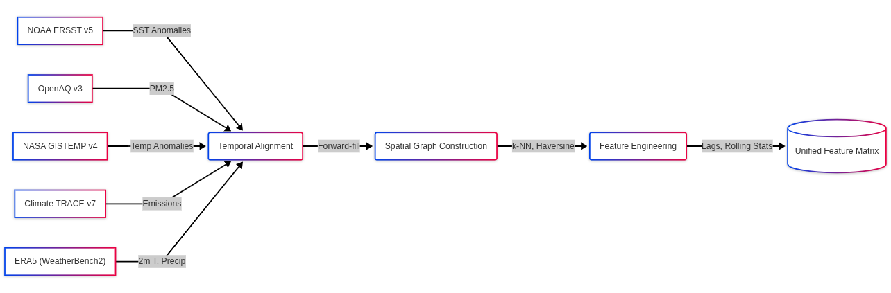
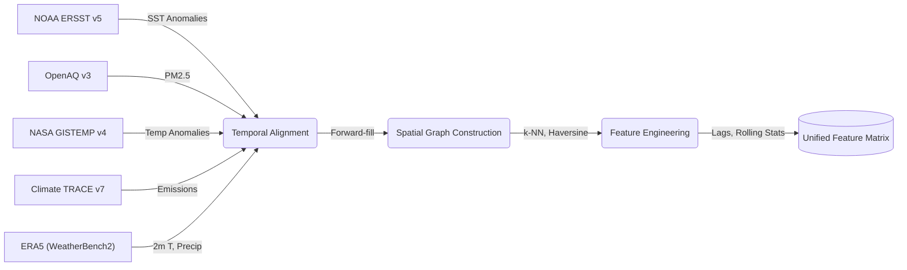
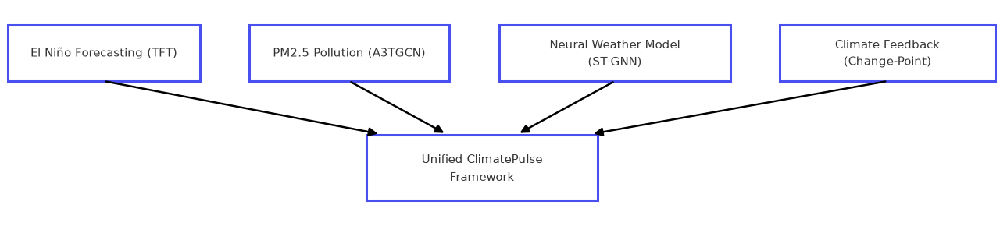
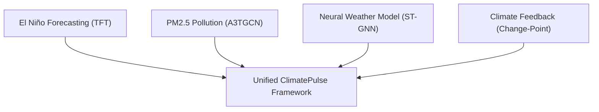

---
header-includes:
  - \usepackage{amsmath}
  - \usepackage{amssymb}
  - \usepackage{unicode-math}
  - \usepackage{fancyhdr}
  - \usepackage[utf8]{inputenc}
  - \usepackage{draftwatermark}
  - \SetWatermarkText{research.aditripaul.org}
  - \SetWatermarkScale{0.25}
  - \SetWatermarkColor[gray]{0.95}
  - \newcommand{\gt}{>}
  - \pagestyle{fancy}
  - '\fancyhead[L]{\small ClimatePulse: Temporal Fusion Transformers and Spatio-Temporal Graph Networks in Climate Modeling}'
  - \fancyhead[R]{\small \today}
  - \fancyfoot[L]{pre-print DRAFT}
  - \fancyfoot[C]{\thepage}
  - \fancyfoot[R]{\footnotesize © 2026 research.aditripaul.org}
  - \renewcommand{\headrulewidth}{0.4pt}
  - \setlength{\headheight}{15pt}
---

# ClimatePulse: Temporal Fusion Transformers and Spatio-Temporal Graph Networks in Climate Modeling

### Authors: Aditri Paul, Dr. Hema Shekhawat
### Manipal University Jaipur


## Abstract

Global climatic phenomena, regional pollution dispersion, and atmospheric field mechanics do not operate in isolation. They form a coupled, multi-scale physical system that no single modelling tradition has adequately captured. ClimatePulse binds four complementary components into one reproducible pipeline: (1) multi-horizon El Niño–Southern Oscillation (ENSO) forecasting via Temporal Fusion Transformers (TFT) with quantile regression; (2) PM2.5 dispersion modelling across 75 global monitoring stations through a 6,984-parameter A3TGCN Spatio-Temporal Graph Neural Network; (3) global weather-field prediction at $5.625^{\circ}$ resolution using a 128-dimensional Encoder-Processor-Decoder Neural Weather Model (NWM) on a 2,000-node Fibonacci spherical mesh, conditioned on the Niño 3.4 index; and (4) piecewise-linear change-point analysis of the global warming rate for climate-feedback analysis.

On a strictly held-out test period (2015–2026), averaged over five training seeds and 1–12 month leads, the TFT reaches RMSE = 0.782 ± 0.075 °C, anomaly correlation ACC = 0.645 and a skill score of 0.427 against persistence; a bidirectional LSTM baseline scores RMSE = 0.809 ± 0.020 °C and skill 0.390. The TFT's advantage is smaller than its own run-to-run spread, and both models are biased cold by about 0.3 °C. On the 85 observed test station-days, the pollution ST-GNN predicts next-day PM2.5 with RMSE 46.6 µg/m³ against 52.0 µg/m³ for persistence, but at the AQI-100 threshold (35.5 µg/m³) its exceedance F1 of 0.828 only equals an always-alert baseline. The NWM predicts 6-hour-ahead 2 m temperature with an area-weighted test RMSE of 1.21 K, half that of persistence (2.46 K); an ablation finds no benefit from Niño 3.4 conditioning (1.20 K without it) and a loss from conditioning on TFT forecasts (1.33 K). Across 76 annual GISTEMP means (1950–2025), a BIC-selected piecewise-linear trend with autocorrelated errors places a single change-point in 1976, where the warming rate rises from 0.03 to 0.21 °C/decade; a second break in 2012 is nearly as well supported but not established.

**Keywords:** Climate forecasting, Temporal Fusion Transformer, Spatio-temporal graph neural networks, Neural Weather Model, Encoder-Processor-Decoder, El Niño–Southern Oscillation, PM2.5 exceedance, Uncertainty quantification, Change-point detection

---

## 1. Introduction

### 1.1 Background and Motivation


Few scientific problems carry the practical urgency of climate change, and fewer still demand the simultaneous command of ocean–atmospheric physics, environmental sensor networks, and probabilistic forecasting. Ocean-atmospheric anomalies — the El Niño–Southern Oscillation (ENSO) chief among them — ripple outward into precipitation regimes, temperature extremes, hurricane frequency, agricultural yields, and regional economic output. Anthropogenic emissions compound the picture. The same industrial processes that drive long-term radiative forcing also generate acute, localised air-pollution crises. Feedback loops between the two operate on timescales ranging from days to decades. Traditional siloed modelling frameworks struggle to capture these interactions.

### 1.2 Challenges in Existing Approaches

Three structural limitations recur across the literature.

- Numerical Weather Prediction (NWP) models, while physically grounded, carry computational latencies that render real-time decision support impractical.

- Data-driven alternatives rarely embed uncertainty quantification in a principled, probabilistic manner. Point forecasts dominate; calibrated prediction intervals are an afterthought.

- Regional pollution-dispersion models tend to operate independently of the global atmospheric anomaly predictors — ENSO phase, sea-surface temperature gradients — that modulate stagnation events and long-range transport.

### 1.3 Research Gap

Separate advances in deep-learning weather forecasting and regional air-quality modelling have been substantial. High-fidelity Earth System Models (ESMs) such as CESM2 [15] preserve physical fidelity but at computational cost. Data-driven approaches like GraphCast [16] and FourCastNet [17] match ESM accuracy at roughly $1000\times$ the speed, yet each remains a single-task system. What the field lacks is a unified, open-source pipeline. Multi-horizon ocean-atmospheric forecasting, sensor-graph air-quality prediction, spherical-mesh neural weather modelling, and statistical change-point analysis have never been coupled into a single reproducible workflow. ClimatePulse occupies that integration gap directly.

### 1.4 Research Questions

Three questions anchor the investigation.

- **RQ1.** Can attention-based Temporal Fusion Transformers with quantile regression outperform bidirectional LSTM baselines on multi-horizon ENSO forecasting, and what is the lead-time degradation profile?

- **RQ2.** Can A3TGCN Spatio-Temporal Graph Neural Networks reliably detect PM2.5 exceedance events with high precision and recall on a real-world global monitoring network?

- **RQ3.** Can an Encoder-Processor-Decoder ST-GNN trained on ERA5 reanalysis data learn global atmospheric mechanics on a Fibonacci spherical mesh without overfitting, and does conditioning on the Niño 3.4 index improve its forecasts?

### 1.5 Key Contributions

Rather than a catalogue of isolated components, ClimatePulse offers a tightly coupled research platform. Four contributions follow from the design.

A) **Framework integration.** An open-source research platform binds TFT-based ENSO forecasting, A3TGCN pollution ST-GNN, an Encoder-Processor-Decoder Neural Weather Model on a Fibonacci spherical mesh, and warming-rate change-point analysis into a single reproducible pipeline. Each module shares data infrastructure and evaluation tooling; none operates as a standalone script.

B) **Rigorous empirical validation.** Evaluation proceeds against persistence and LSTM baselines for ENSO, over five training seeds; against persistence and always-alert baselines for pollution, in physical units with missing readings masked; and against persistence for the NWM, with an ablation of its conditioning input and loss weighting. Normalisation statistics come from training data only. Metrics are generated automatically from the pipeline, not hand-assembled.

C) **Spherical-aware neural weather modelling.** The NWM relies on a 2,000-node Fibonacci lattice mesh with grid-to-mesh, mesh-to-mesh, and mesh-to-grid bipartite GraphSAGE convolution stages. The architecture can condition on the Niño 3.4 index at every processor layer; an ablation tests whether it should. Spherical-awareness is structural, not post-hoc.

D) **Reproducibility.** All data download, training, and evaluation steps are encapsulated in a declarative pipeline (`download-data`, `train`, `gen-eval-artifacts`), producing all paper figures and metrics without manual intervention.

---

## 2. Related Work

### 2.1 Deep Learning for ENSO Forecasting


The attention mechanism introduced by Vaswani et al. [4] underpins the temporal self-attention layer at the heart of the TFT architecture [1]. Lim et al. [1] combine multi-head self-attention with LSTM encoder-decoder layers and gated variable-selection networks, yielding interpretable multi-horizon forecasts. Ham et al. [7] pushed ENSO prediction to 18-month lead times using CNNs trained on climate-model output, though their framework omits calibrated probabilistic outputs. The LSTM of Hochreiter and Schmidhuber [5] remains the principal recurrent baseline; Barnston et al. [6] established the skill-score evaluation standard against persistence that we adopt here.

Where Ham et al. [7] stop at point forecasts, the present work introduces quantile regression for calibrated uncertainty bounds and extends the comparison to include LSTM and persistence baselines across all 12 forecast months simultaneously.

### 2.2 Graph Neural Networks in Air-Quality Modelling


Non-Euclidean sensor networks resist regular-grid convolution, which explains why spatio-temporal graph neural networks have become the default architecture for air-quality forecasting. A3TGCN, introduced by Bai et al. [2], couples spectral graph convolution with GRU temporal evolution and sequence-level soft attention. The GCN spectral convolution foundation traces to Kipf and Welling [8]; diffusion convolutional networks for traffic forecasting (Li et al. [9]) share structural properties with atmospheric dispersion modelling, since both involve advection-diffusion over irregular topologies.

### 2.3 Neural Weather Modelling

Deep learning is increasingly used alongside process models in Earth system science [24]. GraphCast [16] and Keisler [23] pioneered the Encoder-Processor-Decoder approach on icosahedral meshes. FourCastNet [17] takes a different route, deploying Adaptive Fourier Neural Operators on regular grids. The NWM presented here adapts the Encoder-Processor-Decoder architecture to a Fibonacci-lattice spherical mesh with $k$-NN bipartite connectivity and adds ENSO conditioning through an additive MLP mechanism injected at every mesh-processor layer — a coupling absent from prior spherical GNN weather models.

### 2.4 Uncertainty Quantification in Climate Models

Proper scoring rules for probabilistic forecast evaluation were formalised by Gneiting and Raftery [11]. Quantile regression supplies distribution-free probabilistic forecasts [1], while Bayesian methods [12] yield full posterior distributions and credible intervals for change-point analysis. ClimatePulse uses quantile regression for TFT uncertainty; the change-point module selects the number of warming-rate regimes with the Bayesian Information Criterion [26].

---


## 3. Data Pipelines & Processing


### 3.1 Data Sources

Five data streams feed the pipeline.

A) **NOAA ERSST v5** supplies monthly gridded SST anomalies via OPeNDAP. The Niño 3.4 region spans $5^{\circ}$S–$5^{\circ}$N, $170^{\circ}$W–$120^{\circ}$W (170–240°E in the 0–360° convention).

B) **OpenAQ v3** provides real-time PM2.5 measurements, filtered to $|V|=75$ validated stations across India and the United States.

C) **NASA GISTEMP v4** contributes the global land-ocean surface temperature anomaly record (1880–present), consumed by the climate-feedback change-point module.

D) **Climate TRACE v7** delivers sectoral greenhouse-gas emissions ($\text{CO}_2$, $\text{CH}_4$, $\text{N}_2\text{O}$) across 196 countries and 11 sectors.

E) **ERA5 (WeatherBench2)** [22] supplies 6-hourly global reanalysis at $5.625^{\circ}$ resolution. Two variables are extracted — 2 m air temperature and total precipitation — over 2020–2021 (2,924 six-hourly steps).

**Table 1: Dataset Statistics and Coverage**

| Dataset | Temporal Range | Spatial Coverage | Processed Frequency |
|---|---|---|---|
| NOAA ERSST v5 | 1950–2026 (record from 1854) | Global $2^{\circ} \times 2^{\circ}$ | Monthly |
| OpenAQ v3 | 2016–2025 | 75 stations (IN, US) | Daily aggregates |
| NASA GISTEMP v4 | 1950–2026 (record from 1880) | Global land-ocean | Monthly |
| Climate TRACE v7 | 2021–2026 | 93 countries, 7 sectors (as ingested) | Annual |
| ERA5 (WeatherBench2) | 2020–2021 | Global $5.625^{\circ}$ | 6-hourly |





### 3.2 Feature Engineering

A) **El Niño module.** The TFT training set is formatted in long form: integer time index, a single series identifier, and time-varying covariates. Known reals are cyclic month encodings ($\sin(2\pi m/12)$, $\cos(2\pi m/12)$) and the raw month. An optional calendar-year covariate was evaluated and dropped, because it lowered mean validation loss across five seeds when removed (§5.1). Unknown reals comprise the Niño 3.4 target, the Niño 1+2, Niño 3, and Niño 4 indices, and rolling mean and standard deviation of Niño 3.4 over 3-, 6-, and 12-month windows. Missing values (fewer than 2 % of entries) are handled by backward-fill followed by zero-imputation. The resulting feature matrix contains 918 timesteps, split 70/15/15 by time index: training January 1950–June 2003 (642 months, 571 windows), validation July 2003–December 2014 (138 months, 127 windows), and test January 2015–June 2026 (138 months, 127 windows). The TFT and LSTM share these boundaries. Validation and test windows draw their 60-month encoder context from the preceding period, but no training target falls in the validation or test periods, and no validation target falls in the test period.

B) **Pollution module.** OpenAQ coordinates define a proximity graph $\mathcal{G} = (\mathcal{V}, \mathcal{E}, W)$ with $|\mathcal{V}|=75$ nodes and $|\mathcal{E}|=705$ edges (average degree 9.4), constructed via $k$-nearest neighbours ($k=10$) under Haversine great-circle distance. Edge weights $w_{ij} = 1/(d_{ij}+1)$ ($d_{ij}$ in km, edges capped at 500 km) are scaled by the global maximum weight. The ingested record holds 10,000 hourly PM2.5 measurements (the configured download limit) spanning 2016–2025. Aggregated to daily means they cover only 180 distinct dates, with a median of one reporting station per date, so consecutive snapshots are generally *not* consecutive days. Windows of $P=7$ snapshots yield 118 training, 21 validation and 20 test windows. Missing station-days are kept as missing: z-score statistics are computed on the training snapshots only (mean = 122.87, std = 90.47 µg/m³), missing inputs are imputed with the training mean, and missing targets are excluded from the loss and from evaluation.

C) **NWM module.** ERA5 fields are extracted as $[\text{Time}, \text{Lat}, \text{Lon}]$ arrays and independently z-score normalised with cosine-latitude-weighted statistics computed on the training period only. Input tensors are formed by transposing a temporal window of size $W=2$ into $[\text{Lat}\times\text{Lon},\, 2C]$ (2 channels × 2 time steps); the target is the next single step in the same flattened format. The Niño 3.4 scalar for each sample is the value for the calendar month containing its timestamp. Its source is configurable: the observed index, the TFT's lead-1 forecast for that month (issued from data up to the previous month and drawn from the TFT test period, hence out of sample), or a constant zero. Splits follow 70/15/15 by temporal index.

---

## 4. Methodology





### 4.1 El Niño Forecasting: Temporal Fusion Transformer

**Architecture.** Sequence-to-sequence at its core, the TFT [1] layers static covariate encoders, gated residual networks (GRN) for feature selection, and multi-head temporal self-attention into a single stack. The Variable Selection Network (VSN) assigns sparse input weights $\tilde{\mathbf{v}} = \text{Softmax}(\mathbf{W}_v \mathbf{a})$, suppressing irrelevant covariates at each step. Temporal self-attention computes:

$$\mathbf{A}_{t,\tau} = \text{Softmax}\!\left(\frac{Q_t K_\tau^\top}{\sqrt{d_k}}\right), \qquad \hat{\mathbf{y}}_t = \mathbf{A}_{t,\cdot} V$$

where $Q$, $K$, $V$ are linear projections of LSTM encoder hidden states, hidden size $h=32$, attention heads $n=4$.

**Training objective.** Pinball losses summed over quantiles $\tau \in \{0.1, 0.5, 0.9\}$:

$$\mathcal{L}_{\text{TFT}} = \sum_{\tau \in \{0.1, 0.5, 0.9\}} \mathbb{E}\bigl[\rho_\tau(y - \hat{q}_\tau)\bigr], \quad \rho_\tau(u) = u(\tau - \mathbf{1}[u < 0])$$

**Configuration.** Calendar-year covariate excluded (selected on validation loss, §5.1); encoder length 60 months; prediction horizon 12 months; hidden size 32; hidden continuous size 16; attention heads 4; dropout 0.1. Adam ($\beta_1=0.9$, $\beta_2=0.999$, lr = 0.001) with `ReduceLROnPlateau` (patience = 5, factor = 0.5, min_lr = $10^{-5}$), batch size 32, gradient-clip value 0.1, max 100 epochs, early-stopping patience 10.

**LSTM baseline.** Two-layer bidirectional LSTM, hidden size 64 per direction, 142,668 total parameters, dropout rate 0.1. The final hidden state passes through a two-layer MLP ($[128 \to 64 \to 12]$) to produce 12-month forecasts. Adam (lr = 0.001), batch size 32, gradient-clip norm = 1.0, max 100 epochs, patience 15.

**Persistence baseline.** $\hat{y}_{t+k} = y_t \; \forall k = 1,\ldots,12$ (last observed anomaly held constant).

**Seeds and model selection.** The TFT (with and without the calendar-year covariate) and the LSTM are each trained with five seeds. The TFT variant is chosen by mean validation loss; test results are reported for all variants but never used for selection. Figures use a separate main run (seed 42) of the selected configuration.

### 4.2 Spatio-Temporal Pollution Dispersion: A3TGCN

**Architecture.** Operating on the 75-node monitoring graph, the A3TGCN layer [2] processes $X \in \mathbb{R}^{N \times C \times P}$ (nodes, channels, periods $P=7$) through three stages: (1) spectral graph convolution over $\hat{A} = D^{-1/2}(A+I)D^{-1/2}$ for spatial message passing; (2) GRU cells evolving hidden state across $P$ snapshots; (3) soft attention over temporal states $\alpha_p = \text{Softmax}(\mathbf{W}_\alpha \mathbf{h}_p)$. The context-weighted representation $\mathbf{h} \in \mathbb{R}^{N \times 32}$ feeds a two-stage MLP ($[32 \to 16 \to 1]$, ReLU, dropout 0.1). Total parameters: 6,984.

**Training objective.** Mean-squared error on z-score-normalised PM2.5 values over observed station-days $\mathcal{O}$:

$$\mathcal{L}_{\text{STGNN}} = \frac{1}{|\mathcal{O}|} \sum_{(i,t) \in \mathcal{O}} (\hat{y}_{i,t} - y_{i,t})^2$$

**Evaluation.** Predictions are converted back to µg/m³. Exceedance is defined as daily-mean PM2.5 $\ge 35.5$ µg/m³, the US EPA threshold for AQI > 100, and is scored on observed station-days only. Two baselines are reported: persistence (the last input snapshot, with the training mean where missing) and an always-alert classifier.

**Configuration.** Hidden channels 32; temporal periods $P$ = 7; Adam (lr = 0.001) with `ReduceLROnPlateau` (patience = 5, factor = 0.5), one graph window per step, gradient-clip norm = 1.0, 100 epochs with the best-validation checkpoint retained (no early stopping).

### 4.3 Neural Weather Model: Encoder-Processor-Decoder ST-GNN

**Spherical graph construction.** The ERA5 $5.625^{\circ}$ grid yields $N_\text{grid} = 32 \times 64 = 2{,}048$ grid nodes. Each node's position projects to 3-D Cartesian unit-sphere coordinates: $[x, y, z] = [\cos\phi\cos\lambda,\, \cos\phi\sin\lambda,\, \sin\phi]$. A latent mesh of $N_\text{mesh} = 2{,}000$ nodes follows the Fibonacci lattice (golden-angle spiral $\phi_\text{golden} = \pi(3 - \sqrt{5})$), giving near-uniform spherical coverage. Three bipartite edge sets arise from KD-Tree nearest-neighbour lookup: grid-to-mesh ($k=4$ mesh neighbours per grid node), mesh-to-mesh ($k=8$ per mesh node, self-loops excluded), and mesh-to-grid ($k=4$ grid neighbours per mesh node). Per-grid-node static positional features are $[\sin\phi,\, \cos\phi,\, \sin\lambda,\, \cos\lambda]$.

\
**Figure 4c:** The NWM operates on a bipartite graph structure mapping the 2,048 equirectangular ERA5 grid nodes (light coral) to a 2,000-node Fibonacci lattice spherical mesh (royal blue) for isotropic message passing.

**Model architecture.** Five stages compose the NWM pipeline.

*Grid Embedding.* Linear projection + LayerNorm + GELU maps each grid-node input $\mathbf{x}_g \in \mathbb{R}^{2CW+4}$ to latent dimension $d=128$, where $C=2$ channels, $W=2$ input time steps, $+4$ static features.

*Grid-to-Mesh Encoder (Bipartite GraphSAGE).* A SAGEConv layer [21] with LayerNorm and GELU propagates grid features onto the mesh, initialised with zero mesh states:

$$\mathbf{h}_m = \text{GELU}(\text{LN}(\text{SAGEConv}(\mathbf{h}_g,\, \mathbf{0},\, \mathcal{E}_{g \to m})))$$

*Mesh Processor with ENSO Conditioning.* Four GraphSAGE message-passing layers carry residual connections. At each layer $l$, the scalar Niño 3.4 index is projected to dimension $d$ via a 2-layer MLP ($[1 \to d \to d]$, GELU), expanded across all mesh nodes, and additively injected before convolution:

$$\mathbf{h}_m^{(l+1)} = \mathbf{h}_m^{(l)} + \text{GELU}\bigl(\text{LN}(\text{SAGEConv}(\mathbf{h}_m^{(l)} + \mathbf{c},\, \mathcal{E}_{m \to m}))\bigr)$$

where $\mathbf{c} = \text{MLP}_{\text{cond}}(\text{nino}_{3.4}) \in \mathbb{R}^{N_\text{mesh} \times d}$.

*Mesh-to-Grid Decoder (Bipartite GraphSAGE).* Processed mesh representations propagate back to grid nodes, with a skip connection from the encoder output:

$$\mathbf{h}_g^\text{out} = \text{SAGEConv}(\mathbf{h}_m,\, \mathbf{0},\, \mathcal{E}_{m \to g}) + \mathbf{h}_g$$

*Output Projection.* A linear layer maps $\mathbf{h}_g^\text{out} \in \mathbb{R}^{N_\text{grid} \times d}$ to $N_\text{grid} \times 2$ predictions (temperature and precipitation at the next time step).

All bipartite convolutions are vectorised across the batch dimension via edge-index offset expansion.

**Ablation.** Three variants each differ from the main model (observed Niño 3.4, area-weighted loss) in one respect: conditioning on TFT lead-1 forecasts, no conditioning (input fixed at zero), and unweighted MSE loss. All are scored on area-weighted test RMSE in physical units, with 6-hour persistence as reference.

**Training.** AdamW (lr = $10^{-3}$, weight_decay = $10^{-4}$); cosine-latitude-weighted MSE loss on normalised outputs; `ReduceLROnPlateau` (factor = 0.5, patience = 3); gradient clipping (max norm = 1.0); early-stopping patience = 10; best checkpoint saved by minimum validation loss.

### 4.4 Climate Feedback: Warming-Rate Change-Point Detection

**Piecewise linear model.** $K$ unknown change-points in the global temperature anomaly series are modelled as a continuous piecewise-linear trend:

$$\mu(t) = \beta_0 + \beta_1 t + \sum_{k=1}^{K} \delta_k \max(0, t - \tau_k)$$

where $t$ is the calendar year, $\tau_k$ are change-point locations and $\delta_k$ are slope increments, so segment $j$ warms at rate $\beta_1 + \sum_{k \le j} \delta_k$. Continuity is imposed: a regime change alters the warming *rate*, not the temperature level.

**Data.** Annual means of complete calendar years, 1950–2025 ($n = 76$). Annual averaging suppresses intra-annual autocorrelation; the partial final year is excluded.

**Error model.** Residuals follow an AR(1) process, $\varepsilon_t = \phi\,\varepsilon_{t-1} + \eta_t$, $\eta_t \sim \mathcal{N}(0, \sigma^2)$. Coefficients are estimated by two-step Prais–Winsten generalised least squares [27], and the exact Gaussian log-likelihood is evaluated on the whitened series. Ignoring autocorrelation overstates the evidence for additional breaks in climate series.

**Search and model selection.** For each $K \in \{0, 1, 2, 3\}$, every admissible set of change-points on the annual grid (each segment at least 10 years) is fitted exhaustively. $K$ is selected by minimum BIC [26] with $4 + 2K$ parameters: intercept, base slope, $K$ slope increments, $K$ locations, $\sigma$ and $\phi$.

**Simulation check.** On 20 synthetic series each with AR(1) noise ($\phi = 0.5$, innovation s.d. 0.1 °C), the procedure reported a spurious break in 3 of 20 straight-line series (0.15 °C/decade), and found a break in 19 of 20 series with a true 1975 regime change (flat, then 0.18 °C/decade), locating it between 1968 and 1990.

A mean-shift CUSUM test is not suited to this question: it detects changes in level rather than slope, and on a trending series reports spurious breaks (12 on the monthly GISTEMP record).

### 4.5 Model Training Configuration Summary

| Model | Optimizer | LR | Batch Size | Grad Clip | Max Epochs | Early Stopping |
|---|---|---|---|---|---|---|
| TFT | Adam | 0.001 | 32 | 0.1 | 100 | 10 (val quantile loss) |
| LSTM Baseline | Adam | 0.001 | 32 | 1.0 | 100 | 15 (val MSE) |
| A3TGCN | Adam | 0.001 | 1 (graph window) | 1.0 | 100 | — |
| NWM ST-GNN | AdamW | 0.001 | 32 | 1.0 | 100 | 10 (val MSE) |

---

## 5. Experimental Results & Discussion

### 5.1 El Niño Forecasting Performance

Evaluation uses the held-out test period (March 2015–September 2026, 128 forecast windows × 12 leads). Metrics: RMSE (°C), MAE (°C), Anomaly Correlation Coefficient (ACC), mean error (bias, °C), and skill score $\text{SS} = 1 - \text{MSE}_{\text{model}}/\text{MSE}_{\text{persistence}}$.

**Across seeds.** Table 2 summarises five training seeds per configuration. Removing the calendar-year covariate lowered mean validation loss (0.283 vs. 0.331), so the TFT without it is the selected model. Test results for both variants are shown for transparency.

| Model | Val. loss | RMSE (°C) | ACC | Skill Score | Bias (°C) |
|---|---|---|---|---|---|
| TFT, without year (selected) | 0.283 ± 0.016 | 0.782 ± 0.075 | 0.645 ± 0.023 | 0.427 ± 0.113 | −0.321 ± 0.146 |
| TFT, with year | 0.331 ± 0.036 | 0.838 ± 0.070 | 0.483 ± 0.193 | 0.341 ± 0.106 | −0.242 ± 0.141 |
| LSTM Baseline | 0.342 ± 0.006 | 0.809 ± 0.020 | 0.562 ± 0.035 | 0.390 ± 0.029 | −0.268 ± 0.078 |
| Persistence Baseline | — | 1.036 | 0.383 | 0.000 | +0.062 |

*Table 2: Mean ± standard deviation over five seeds. Validation loss is quantile loss for the TFT and MSE for the LSTM, so it is comparable only within a model.*

Source: `docs/research_paper/artifacts/eval_artifacts/run_results/elnino_seeds.csv`

Both learned models clearly beat persistence. On average the selected TFT edges the LSTM (RMSE 0.782 vs. 0.809 °C, ACC 0.645 vs. 0.562), but the difference is smaller than the TFT's own run-to-run spread, which is nearly four times the LSTM's (RMSE s.d. 0.075 vs. 0.020 °C). The two architectures should therefore be regarded as comparable on this record, with the LSTM the more reliable to train.

Both models are biased cold (−0.32 and −0.27 °C). Removing the calendar-year covariate did not remove this bias, and the LSTM, which never sees the year, shares it. The likelier cause is non-stationarity: mean Niño 3.4 anomaly rises from −0.23 °C in the training period to +0.14 °C in the test period, and models fitted to the earlier climate under-predict the later one.

**Main run.** The figures below come from a separate run (seed 42) of the selected configuration. This run's TFT is better than the five-seed mean (RMSE 0.684 vs. 0.782 °C, about 1.3 standard deviations), so the seed averages above are the more representative estimate:

| Model | RMSE (°C) | MAE (°C) | ACC | Skill Score | Bias (°C) |
|---|---|---|---|---|---|
| TFT | 0.6838 | 0.5237 | 0.7041 | 0.5644 | −0.2066 |
| LSTM Baseline | 0.7984 | 0.6133 | 0.5569 | 0.4063 | −0.2364 |
| Persistence Baseline | 1.0361 | 0.7510 | 0.3835 | 0.0000 | +0.0617 |

Source: `docs/research_paper/artifacts/eval_artifacts/run_results/summary_metrics.json`

Per-lead-time RMSE sharpens the picture:

| Lead Time (months) | TFT RMSE (°C) | LSTM RMSE (°C) | Persistence RMSE (°C) |
|---|---|---|---|
| 1 | 0.394 | 0.324 | 0.247 |
| 3 | 0.525 | 0.542 | 0.609 |
| 6 | 0.704 | 0.862 | 1.032 |
| 9 | 0.765 | 0.927 | 1.269 |
| 12 | 0.856 | 0.934 | 1.376 |

Source: `docs/research_paper/artifacts/eval_artifacts/run_results/elnino_lead_time_metrics.csv`

Persistence is best at 1 month (RMSE 0.247 °C) and degrades to 1.376 °C by month 12. The LSTM overtakes it from month 2 and the TFT from month 3. The LSTM is more accurate than the TFT at 1–2 months; the TFT is more accurate at every lead from 3 to 12 months. In answer to RQ1, the TFT's advantage lies at longer leads, and across seeds it is smaller than its run-to-run variability.

**Calibration.** The TFT 80 % prediction interval (10th–90th quantiles) covers 75.7 % of test observations, with an average width of 1.49 °C. The quantiles are shifted rather than merely too narrow: 8.2 % of observations fall below the 10th percentile, 34.9 % below the median and 83.9 % below the 90th percentile, against nominal 10 %, 50 % and 90 %. This is the cold bias seen from the probabilistic side.

\
**Figure 1:** 12-month SST anomaly forecast for a single held-out test sequence: TFT median (blue) and LSTM baseline (red, dashed) versus observed Niño 3.4 values (black). The shaded region is the TFT 10th–90th percentile interval, which contains the observations throughout this sequence while both medians sit below them from month 2 to month 8.

\
**Figure 2:** RMSE as a function of forecast lead time. Persistence (green, dashed) is lowest at 1 month; the LSTM (red) is lower than the TFT (blue) at 1–2 months and higher from month 3; the LSTM beats persistence from month 2 and the TFT from month 3.

\
**Figure 2b:** TFT quantile calibration on the test set: observed frequency of outcomes below the predicted 10th, 50th and 90th percentiles. Points below the diagonal indicate forecasts that are too low.

\
**Figure 3:** Scatter of predicted vs. observed SST anomalies for the TFT (blue) and LSTM (red); the dashed line marks a perfect forecast.

\
**Figure 3b:** Heatmap of absolute forecast errors across lead horizons (1–12 months) and chronological test windows.

\
**Figure 3c:** 6-month ahead TFT median forecast (blue) and 10th–90th percentile interval (shaded) versus observed values (black) across the chronological test set. The forecast reproduces the timing of the 2015–16 and 2023–24 El Niño events but underestimates their peaks, and it lags several transitions by a few months.

### 5.2 Spatio-Temporal Pollution Dispersion Validation

The test split holds 20 windows over the 75-node graph, i.e. 1,500 station-days, of which only **85 have a PM2.5 reading**, from 36 stations; 62 of them fall on two dates. All metrics below use these 85 observed station-days.

| Metric | A3TGCN | Persistence | Always alert |
|---|---|---|---|
| RMSE (µg/m³) | 46.6 | 52.0 | — |
| MAE (µg/m³) | 40.1 | — | — |
| F1, PM2.5 $\ge$ 35.5 µg/m³ (AQI > 100) | 0.828 | 0.881 | 0.828 |
| Precision / Recall | 0.706 / 1.000 | — | — |

Source: `docs/research_paper/artifacts/eval_artifacts/run_results/summary_metrics.json`

The model's concentration error is about 10 % lower than persistence. For exceedance, however, it predicts AQI > 100 for every observed station-day, so its scores equal those of the always-alert classifier (70.6 % of observed station-days exceed the threshold), and persistence scores higher. In answer to RQ2, the A3TGCN does not demonstrate exceedance-detection skill on this record, and with 85 test observations no pollution result here is statistically robust.

Per-station RMSE (from `docs/research_paper/artifacts/eval_artifacts/run_results/pollution_node_rmse.csv`) has a median of 46.8 µg/m³ and a maximum of 85.2 µg/m³ across the 36 stations with test readings.

\
**Figure 4:** Distribution of per-station RMSE (µg/m³) across the 36 stations with test readings.

\
**Figure 4b:** Exceedance confusion matrix at PM2.5 $\ge$ 35.5 µg/m³ (AQI > 100) on observed test station-days: 60 true positives, 25 false positives, no false negatives and no true negatives.

### 5.3 Neural Weather Model Performance & Convergence

Training ran for 81 epochs (0–80) before early stopping. The best validation checkpoint landed at epoch 70 (area-weighted validation MSE = 0.1173 on normalised fields); the final epoch recorded training MSE = 0.1070 and validation MSE = 0.1174.

| Metric | Epoch 0 | Best (Epoch 70) | Final (Epoch 80) |
|---|---|---|---|
| Training Loss (MSE) | 0.2861 | 0.1079 | 0.1070 |
| Validation Loss (MSE) | 0.1939 | 0.1173 | 0.1174 |

Source: `docs/research_paper/artifacts/eval_artifacts/run_results/nwm_metrics.csv`

From epoch 0 to 80, training loss fell 62.6 % (0.2861 → 0.1070); validation loss dropped 39.5 % (0.1939 → 0.1173 at best). The 8.7 % train-validation gap at the best checkpoint (0.1079 vs. 0.1173) is a mild overfitting signal, not a pathological one. Normalisation statistics are computed on the training period only.

**Test skill.** On the 438 held-out test samples, the main model predicts 2 m temperature 6 hours ahead with an area-weighted RMSE of **1.214 K**, half that of persistence (2.457 K). For total precipitation the RMSE is $6.82 \times 10^{-4}$ m per 6 h against $9.03 \times 10^{-4}$ for persistence, a 24 % reduction.

**Ablation.** Table 3 scores each variant on the same test samples.

| Variant | Niño 3.4 input | Loss | Epochs | T2m RMSE (K) | Precip RMSE (m / 6 h) |
|---|---|---|---|---|---|
| Main model | observed | area-weighted | 81 | 1.214 | $6.82 \times 10^{-4}$ |
| Forecast-conditioned | TFT lead-1 forecast | area-weighted | 85 | 1.335 | $6.83 \times 10^{-4}$ |
| Unconditioned | none (zero) | area-weighted | 79 | 1.195 | $6.80 \times 10^{-4}$ |
| Unweighted loss | observed | unweighted | 85 | 1.164 | $6.79 \times 10^{-4}$ |
| Persistence | — | — | — | 2.457 | $9.03 \times 10^{-4}$ |

*Table 3: NWM ablation on the test period. RMSE is area-weighted by cos(latitude) for every variant; each variant was trained once.*

Source: `docs/research_paper/artifacts/eval_artifacts/run_results/nwm_ablation.csv`

The Niño 3.4 conditioning does not help. The unconditioned model is marginally more accurate than the main model (1.195 vs. 1.214 K), and conditioning on the TFT's forecasts is the worst variant (1.335 K). The area-weighted loss does not help either: the model trained with an unweighted loss scores best (1.164 K) even on the area-weighted metric. Precipitation RMSE barely differs between variants. Since each variant was trained once, differences of a few hundredths of a kelvin are within the range that a change of seed could produce; the forecast-conditioned model's deficit of about 0.12 K is the only one large enough to read as a real effect.

These results are not surprising. Over a 6-hour step, the recent atmospheric state carries far more information than a monthly ENSO index, and the 2020–2021 record contains a single La Niña episode, so a monthly index that barely varies offers little to learn from. Feeding the TFT's forecast instead of the observed index adds forecast error to a signal that the model was not using productively. In answer to RQ3, the spherical-mesh NWM learns the 6-hour dynamics well enough to halve persistence error without overfitting, but on this record the ENSO conditioning pathway gives no measurable benefit.

\
**Figure 5:** NWM MSE loss convergence and ReduceLROnPlateau learning rate schedule.

\
**Figure 5b:** Global 2m temperature field prediction (middle) versus ERA5 ground truth (left) for a held-out test sample, alongside the prediction error (right). Sample RMSE = 1.15 K.

\
**Figure 5c:** Time-averaged 2m temperature RMSE per grid node across the entire test set (area-weighted global 1.21 K, tropical 0.84 K, polar 1.55 K).

### 5.4 Warming-Rate Change-Point Analysis

Applied to 76 annual means of NASA GISTEMP v4 global temperature anomalies (1950–2025), BIC selects a single change-point ($K = 1$) in **1976**. The warming rate rises from 0.035 °C/decade (1950–1976) to 0.211 °C/decade (1976–2025). The residual AR(1) coefficient is $\phi = 0.27$.

| Change-points $K$ | 0 | 1 | 2 | 3 |
|---|---|---|---|---|
| BIC | −105.7 | **−114.1** | −113.7 | −105.7 |

Source: `docs/research_paper/artifacts/eval_artifacts/run_results/climate_feedback_results.json`

Two qualifications apply. First, the location is loosely constrained: single-break years from 1970 to 1986 lie within ΔBIC < 2 of the optimum, so the result supports a mid-1970s regime change rather than a specific year. Second, the two-break model is nearly tied (ΔBIC = 0.4). Its best fit places breaks in 1971 and 2012, with a final-segment rate of 0.363 °C/decade. The record is therefore consistent with a recent acceleration of warming but does not establish one.

The robust finding is a transition from near-zero warming in the 1950s–1970s to sustained warming of about 0.2 °C/decade, consistent with the growing dominance of greenhouse-gas forcing over aerosol cooling in that period.

\
**Figure 6:** GISTEMP global temperature anomalies: monthly values (grey), annual means (black points), and the BIC-selected continuous piecewise-linear trend (red) with the 1976 change-point (dashed). Segment warming rates are 0.03 and 0.21 °C/decade.

### 5.5 Architecture Analysis

The ENSO results do not support a general advantage for the TFT over the LSTM. The TFT's higher anomaly correlation suggests that attention over a 60-month context window does capture the phase of the oscillation; that advantage is offset by its cold bias and by large run-to-run variability. With only 571 training windows, a 100k-parameter TFT is likely data-limited, and its additional covariates offer more ways to extrapolate poorly into a test period whose mean state differs from training; the calendar year as a known real was the clearest case, and removing it lowered both validation loss and test error.

The NWM ablation qualifies the case for cross-domain coupling. Conditioning a 6-hour weather model on a monthly ENSO index added nothing measurable on a two-year record, and routing the TFT's forecasts into it made it worse. Coupling the modules through a shared pipeline is useful for reproducibility; coupling them through model inputs has to be justified per task, and here it is not.

In the pollution module, soft temporal attention weights recent accumulation events differently from distant ones. Graph convolution aggregates neighbouring-station signals, capturing wind-driven dispersion that a purely temporal model would miss.

The spherical mesh in the NWM decouples latent computation from the observation grid. Equirectangular distortion at high latitudes — a persistent artefact in regular-grid GNNs — is structurally avoided.

For the change-point module, modelling autocorrelated errors and selecting the number of regimes by BIC guards against the over-segmentation that i.i.d. or mean-shift methods produce on trending climate series; the cost is that weakly supported regimes, such as a post-2012 acceleration, cannot be confirmed from 76 annual values.

### 5.6 Limitations & Probabilistic Calibration

**TFT stability and calibration.** The 60-month lookback window is a hard requirement. More pressing, TFT test skill varies between seeds of identical code (skill s.d. 0.11 over five seeds, against 0.03 for the LSTM), so single-run TFT figures, including the main run in §5.1, should be read alongside the seed averages. Both models carry a cold bias of about 0.3 °C, which is consistent with the warmer mean state of the test period. The 80 % prediction interval covers 75.7 % of observations, and the miss is mostly on the warm side (16.1 % above the 90th percentile, 8.2 % below the 10th). Split Conformal Quantile Regression (CQR) is the planned corrective for the interval width, but it cannot by itself remove a bias that differs between calibration and test periods. Non-conformity scores $s_i = \max(\hat{q}_{0.1}(x_i) - y_i,\; y_i - \hat{q}_{0.9}(x_i))$ computed on a held-out calibration split would adjust interval bounds by a finite-sample correction quantile $Q_{1-\alpha}(s)$, guaranteeing $\ge 80\%$ marginal coverage with distribution-free validity.

**ST-GNN.** The test split contains only 85 observed station-days, 62 of them on two dates, so neither the RMSE gain over persistence nor the exceedance scores are statistically robust. With 70.6 % of observed station-days above the AQI-100 threshold, an always-alert classifier is a strong baseline, and the model does not beat it. The 75-station graph is static, adding stations requires retraining, and geographic coverage concentrates in India and the United States.

**NWM.** The 2020–2021 ERA5 window offers limited temporal diversity: it spans a single ENSO phase, which limits any test of ENSO conditioning. Each ablation variant was trained once, so small differences between variants are not resolved. At $5.625^{\circ}$ resolution, mesoscale phenomena are smoothed beyond recovery.

### 5.7 Computational Efficiency

The full pipeline runs on a single workstation; the results reported here were produced on CPU only. Training the main models took about 2.2 hours, dominated by the NWM (about 2 hours, roughly 90 s per epoch); the El Niño, pollution and change-point models each train in under 5 minutes. The robustness studies add about 6 hours: the five-seed El Niño study and, mostly, the three NWM ablation variants, trained in parallel in about 5 hours. Inference across all models, plus complete artifact generation, finishes in a few minutes.

\
**Figure 7:** Training (blue) and validation (red dashed) loss trajectories for all four deep learning architectures.

---

## 6. Conclusion

ClimatePulse began as an integration problem: four modelling tasks, each well-studied in isolation, none previously coupled in a single reproducible pipeline. The empirical record from this work speaks to whether that coupling is productive.

For ENSO forecasting on a strictly held-out 2015–2026 test period, the TFT averages RMSE = 0.782 °C, ACC = 0.645 and a skill score of 0.427 against persistence over five seeds; the LSTM baseline averages 0.809 °C, 0.562 and 0.390. The TFT is more accurate from 3 months' lead onward, but its margin over the LSTM is smaller than its run-to-run spread, and both models are biased cold by about 0.3 °C. The pollution ST-GNN improves on persistence for next-day PM2.5 (RMSE 46.6 vs. 52.0 µg/m³) but does not beat an always-alert baseline for AQI-100 exceedance, on only 85 observed test station-days. The NWM halves the persistence error for 6-hour 2 m temperature (1.21 vs. 2.46 K), while an ablation shows that its Niño 3.4 conditioning brings no measurable benefit and that conditioning on TFT forecasts degrades it. Across 76 annual GISTEMP means, warming shows a regime change in the mid-1970s (best estimate 1976), from 0.03 to 0.21 °C/decade; a further acceleration around 2012 is suggested but not established.

The integration itself works: one pipeline downloads, trains, evaluates and documents all four components, and every figure in this paper can be rebuilt from it. The empirical results are, however, more modest than the architectures' reputations suggest, and the proposed cross-domain conditioning of the weather model is not supported by this record.

Four directions follow. The most immediate is diagnostic: the source of the shared ENSO cold bias, and a pollution test set large enough to measure exceedance skill. Beyond that, multi-year NWM training, spanning several ENSO phases and longer lead times, is needed before ENSO conditioning can be properly tested. Multi-regional TFT extensions to the Indian Ocean Dipole and North Atlantic Oscillation would test whether the architecture generalises beyond ENSO. Satellite $\text{NO}_2$ and methane integration would broaden pollution coverage beyond the current 75-station footprint.

---

## 7. Code and Data Availability

**Code Repository:** https://github.com/aditripaul/climatepulse (GPL v3.0 License)

```bash
git clone https://github.com/aditripaul/climatepulse && cd climatepulse
make install                   # Creates .venv and installs all dependencies
make download-data             # NOAA, OpenAQ, NASA GISTEMP, Climate TRACE
make download-nwm-data         # ERA5 WeatherBench2 subset
make train                     # Trains all models
make gen-eval-artifacts        # Generates all metrics, figures, summary
```

**Datasets (All Publicly Accessible):**

- NOAA ERSST v5: https://psl.noaa.gov/data/gridded/data.noaa.ersst.v5.html
- OpenAQ v3: https://openaq.org/
- NASA GISTEMP v4: https://data.giss.nasa.gov/gistemp/
- Climate TRACE v7: https://climatetrace.org/
- ERA5 / WeatherBench2: https://weatherbench2.readthedocs.io/

**Trained Model Checkpoints:** [Zenodo DOI: 10.5281/zenodo.XXXXXXX] (to be assigned upon publication)

---

## 8. Ethics and Broader Impacts

Every dataset consumed here is publicly available. Model outputs display uncertainty bounds prominently; accompanying documentation frames predictions as complementary to, not a replacement for, expert scientific judgement. Open-source release under GPL v3.0 invites community scrutiny and reproducibility checks.

---

## Acknowledgments

We thank the NOAA Physical Sciences Laboratory, OpenAQ, NASA GISS, Climate TRACE, and the ERA5/WeatherBench2 team for providing open-access datasets.

---

## References

[1] Lim, B., Arık, S. Ö., Loeff, N., & Pfister, T. (2021). Temporal Fusion Transformers for Interpretable Multi-horizon Time Series Forecasting. *International Journal of Forecasting*, 37(4), 1748–1764.

[2] Bai, J., Zhu, J., Song, Y., Zhao, L., Hou, Z., Du, R., & Li, H. (2021). A3T-GCN: Attention Temporal Graph Convolutional Network for Traffic Forecasting. *ISPRS International Journal of Geo-Information*, 10(7), 485.

[4] Vaswani, A., Shazeer, N., Parmar, N., Uszkoreit, J., Jones, L., Gomez, A. N., Kaiser, Ł., & Polosukhin, I. (2017). Attention is All You Need. *NeurIPS*, 30.

[5] Hochreiter, S., & Schmidhuber, J. (1997). Long Short-Term Memory. *Neural Computation*, 9(8), 1735–1780.

[6] Barnston, A. G., Tippett, M. K., L'Heureux, M. L., Li, S., & DeWitt, D. G. (2012). Skill of Real-Time Seasonal ENSO Model Predictions During 2002–11. *BAMS*, 93(5), 631–651.

[7] Ham, Y. G., Kim, J. H., & Luo, J. J. (2019). Deep Learning for Multi-year ENSO Forecasts. *Nature*, 573, 568–572.

[8] Kipf, T. N., & Welling, M. (2017). Semi-Supervised Classification with Graph Convolutional Networks. *ICLR 2017*.

[9] Li, Y., Yu, R., Shahabi, C., & Liu, Y. (2018). Diffusion Convolutional Recurrent Neural Network: Data-Driven Traffic Forecasting. *ICLR 2018*.

[11] Gneiting, T., & Raftery, A. E. (2007). Strictly Proper Scoring Rules, Prediction, and Estimation. *JASA*, 102(477), 359–378.

[12] Gelman, A., Carlin, J. B., Stern, H. S., Dunson, D. B., Vehtari, A., & Rubin, D. B. (2013). *Bayesian Data Analysis* (3rd ed.). CRC Press.


[15] Danabasoglu, G., et al. (2020). The Community Earth System Model Version 2 (CESM2). *JAMES*, 12(2), e2019MS001916.

[16] Lam, R., Sanchez-Gonzalez, A., Willson, M., et al. (2022). GraphCast: Learning Skillful Medium-Range Global Weather Forecasting. *arXiv:2212.12794*.

[17] Pathak, J., Subramanian, S., Harrington, P., et al. (2022). FourCastNet: A Global Data-Driven High-Resolution Weather Model Using Adaptive Fourier Neural Operators. *arXiv:2202.11214*.


[21] Hamilton, W. L., Ying, R., & Leskovec, J. (2017). Inductive Representation Learning on Large Graphs. *NeurIPS*, 30.

[22] Hersbach, H., et al. (2020). The ERA5 Global Reanalysis. *QJRMS*, 146(730), 1999–2049.

[23] Keisler, R. (2022). Forecasting Global Weather with Graph Neural Networks. *arXiv:2202.07575*.

[24] Reichstein, M., Camps-Valls, G., Stevens, B., et al. (2019). Deep Learning and Process Understanding for Data-Driven Earth System Science. *Nature*, 566, 195–204.


[26] Schwarz, G. (1978). Estimating the Dimension of a Model. *Annals of Statistics*, 6(2), 461–464.

[27] Prais, S. J., & Winsten, C. B. (1954). Trend Estimators and Serial Correlation. *Cowles Commission Discussion Paper*, Statistics No. 383.
